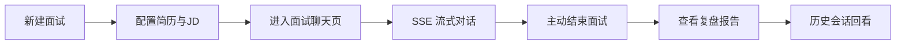
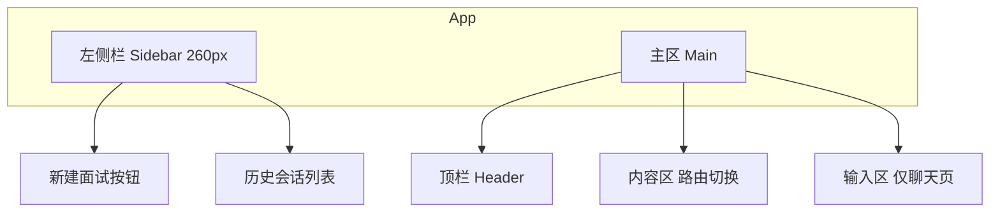
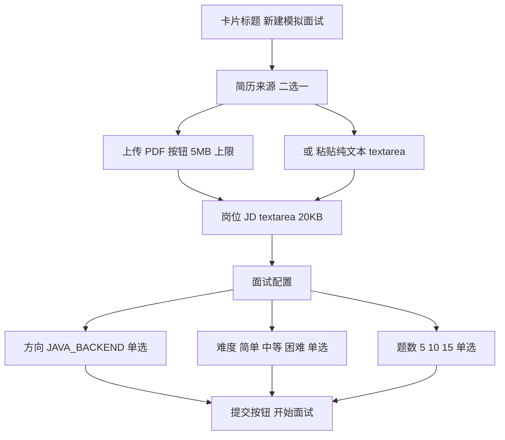
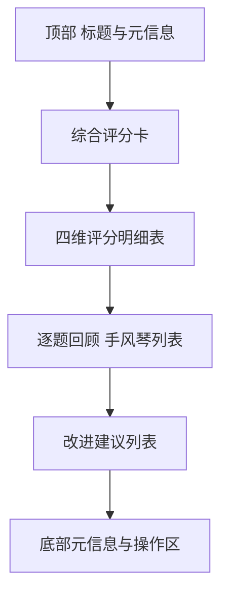
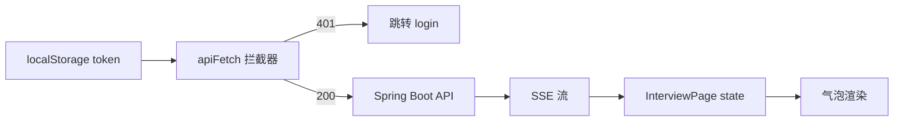

# AI 模拟面试平台 前端页面 优化方案

作者:Sakura | 创建时间:2026-10-29 22:35 | 视觉定稿:2026-10-29（用户确认 travelScope 简约风、全站无 emoji；2026-10-31 复审维持）

> 2026-11-01 修订：登录页由令牌输入改为账号密码登录/注册（认证改造），涉及 1.1、2、3.1、3.2、4.5、5、7、8 节。

承接《AI模拟面试平台-技术方案》第 7 节"Web 层：自写极简页面（对话流、简历上传、报告展示），SSE 流式渲染"，《AI模拟面试平台-接口文档》第 4 节接口清单。本方案只覆盖**前端工程**，对应开发步骤 7 中"REST 全套 SSE 与极简 Web 页面"的 Web 部分。视觉与交互风格沿用同机参考项目 `D:\travelScope\TravelScope\frontend`（React 19 + Vite + TypeScript + 纯 CSS、左侧栏 + 主聊天区 + SSE 流式气泡 + Markdown 渲染 + Agent 活动流）。

## 1 目标与边界

### 1.1 要做什么

为 AI 模拟面试平台搭建浏览器 WebUI，让用户完成面试完整闭环：



页面清单（4 个主视图 + 1 个登录视图）：

1. **新建面试页** `/new`：上传/粘贴简历、粘贴 JD、选择方向/难度/题数，提交后跳转面试页
2. **面试聊天页** `/interview/:id`：核心页面，SSE 流式渲染面试官提问、用户作答、追问、换题，顶栏提供"结束面试"按钮
3. **复盘报告页** `/report/:id`：结构化评分、逐题回顾、改进建议
4. **历史会话列表** `/`：左侧栏形式的历史会话入口（沿用 travelScope 布局），主区为空状态引导
5. **登录/注册页** `/login`：用户名密码登录与注册（注册即登录），存会话令牌到 localStorage，对应接口文档 4.0 认证接口（2026-11-01 修订，替代原令牌输入页）

### 1.2 明确不做

- 不做移动端适配（只保证桌面 Chrome 正常）
- 不做华丽视觉：无插画、无渐变、无动效库、无 emoji 图标（见第 6.1 节视觉定稿）
- 不做语音作答、图片作答（P1 二期）
- 不做报告 PDF 导出实功能（P1 二期，仅留占位按钮）

## 2 技术选型（与 travelScope 完全对齐，降低复制成本）

| 项 | 选型 | 说明 |
|---|---|---|
| 构建 | Vite 8 + TypeScript | 与 travelScope 同 |
| 框架 | React 19 + react-router-dom 7 | 与 travelScope 同 |
| Markdown | react-markdown + remark-gfm | 复用 travelScope 的 sanitize 逻辑 |
| 样式 | 纯 CSS（`App.css` 单文件） | 不引 Tailwind / antd，与 travelScope 一致 |
| HTTP | 原生 fetch + 手写 SSE 解析 | 复用 travelScope `parseSse`（接口文档明确要求 fetch 而非 EventSource） |
| 鉴权 | localStorage 存会话令牌（键沿用 `APP_TOKEN`）与用户名，apiFetch 自动加 `Authorization: Bearer` | 注册/登录/登出走 auth.ts（2026-11-01 修订） |
| 图表 | 不引库，评分用 CSS 表格 + 进度条 | 极简 |

工程位置：项目根新增 `frontend/` 子目录，与后端 `src/` 平级。开发期 Vite 起 5173 端口，proxy 转发 `/api` 到 `http://localhost:8080`；生产期 `vite build` 产物拷到 `src/main/resources/static/`，由 Spring Boot 直接服务，docker-compose 单容器即可演示。

## 3 信息架构

### 3.1 路由

```text
/login                登录与注册
/                     历史会话列表（左侧栏布局，主区显示空状态引导）
/new                  新建面试
/interview/:id        面试聊天（仅 IN_PROGRESS 状态可进入）
/report/:id           复盘报告（ENDED 与 REPORTED 状态）
*                     重定向 /
```

路由守卫 `RequireAuth`：未存 token 一律跳 `/login`。

### 3.2 页面骨架（沿用 travelScope 左右分栏）



**左侧栏（所有页共享）**：

- 顶部：品牌文字"AI 模拟面试"（纯文字，无图标）+ "＋ 新建面试"虚线按钮（travelScope 的 `new-chat-btn`）
- 中部：会话列表，每项两行——"方向 · 难度"与"第 N/M 题 · 时间 + 状态徽章"；点击按状态路由（IN_PROGRESS → `/interview/:id`；ENDED/REPORTED → `/report/:id`）
- 底部：当前用户名 + 退出登录（调登出接口并清本地令牌，2026-11-01 修订；难度筛选下拉仍为待确认项）

**顶栏（主区顶部）**：

- 左侧：页面标题（面试页为"面试中 · Java 后端 · 中等难度 · 第 3/10 题"）
- 右侧：状态徽章 + 主操作按钮（聊天页为红色"结束面试"，报告页为"查看消息记录"链接）

## 4 页面设计详述

高保真设计稿已定稿，位于 `frontend/design-mockups/`（预览：`node frontend/serve.js` 后访问 `http://127.0.0.1:8765`）。以下描述与设计稿一一对应。

### 4.1 新建面试页 `/new`

布局：主区居中卡片（约 720px 宽），纵向三段表单。



字段约束（对应接口文档 4.1）：

- 简历 PDF 与纯文本二选一，选中一种后另一种禁用
- 提交后调 `POST /api/interviews` → 拿 `sessionId` → 立即调 `POST /api/interviews/{id}/start` → 跳 `/interview/:id`
- 失败时表单顶部红色错误条提示；401 统一跳 `/login`

### 4.2 面试聊天页 `/interview/:id`（核心）

布局沿用 travelScope 聊天页结构（左栏会话 + 右侧消息流 + 底部输入区），顶栏与输入区替换为面试语义：


**消息气泡类型**（映射接口文档 4.3 SSE 事件）：

| SSE 事件 | 前端渲染 |
|---|---|
| `message`（delta 累积） | 面试官气泡正文，流式追加 + 光标 `▌` |
| `action` type=QUESTION | 当前气泡前缀文字徽章：`第 N 题`（蓝底） |
| `action` type=FOLLOW_UP | 当前气泡前缀文字徽章：`追问`（黄底） |
| `action` type=NEXT | 当前气泡前缀文字徽章：`下一题`（紫底） |
| `metrics` | 累积到气泡底部小字：`tokens: 1234 · 5.6s` |
| `done` | 关流，去光标，刷新左侧会话列表 |

**Agent 活动流**（沿用 travelScope `ActivityStream` 组件）：气泡下方灰色小字流（最近 4 条、更旧淡出、可折叠）。面试页 P0 事件较少（路由 → Supervisor → 面试官），保留组件与折叠 UI，标题为纯文字"Agent 活动（N）"。

**顶栏右侧主按钮**：

- IN_PROGRESS：红色"结束面试"→ confirm 确认 → `POST /api/interviews/{id}/end` → 跳 `/report/:id`
- ENDED（报告生成中）：顶栏显示"报告生成中"黄色徽章，报告页轮询兜底

**底部输入区**：textarea 自动高度（2-6 行），Enter 发送、Shift+Enter 换行。streaming 时输入框禁用、发送按钮换成红色"停止"（abortRef 中断读流，与 travelScope 一致）。

### 4.3 复盘报告页 `/report/:id`

布局：主区滚动单列，宽度 860px 居中。



- **综合评分卡**：白底扁平卡片，大号蓝色数字显示 `scores.overall`（满分 10），旁配日期/时长/题数/难度元信息与一句话结论（取 `suggestions` 首条）
- **四维评分明细**：行 = overall / technicalDepth / expression / followUpHandling，列 = 维度名 / 得分 / CSS 进度条（纯色，不用渐变）
- **逐题回顾**：`items[]` 每题一个 `<details>` 手风琴：summary 显示题号徽章 + 得分 + 题干截断 50 字，展开显示题目全文、回答摘要、面试官评语（左侧蓝色竖线引用样式）、单题得分
- **改进建议**：`suggestions` 列表，编号 + 加粗主题 + 说明；末尾虚线框显示"继续保持"项
- **元信息**：底部居中等宽字体一行——`Token 消耗：12,847 · 面试时长：32 分 18 秒 · 模型：qwen-plus`
- **报告生成中兜底**：进入页面时若 `GET /report` 返回 `code: 202`，显示旋转 loading + 分步进度（消息汇总 → 逐题评分 → 生成建议 → 汇总输出），3 秒轮询直到拿到完整报告

### 4.4 历史会话列表 `/`（左栏内嵌）

复用 travelScope 左栏 `conversation-list` 样式：

- 每项两行：`{direction} · {difficulty}` + 状态徽章；`第 N/M 题 或 综合 X.X` + `{时间}`
- 状态徽章为彩色文字（不用 emoji）：IN_PROGRESS 蓝"进行中" / ENDED 黄"待生成" / REPORTED 绿"已出报告"
- 点击：IN_PROGRESS → `/interview/:id`；ENDED 与 REPORTED → `/report/:id`（轮询兜底）
- 主区空状态为纯文字引导 + "新建面试"主按钮（无插画）

### 4.5 登录/注册页 `/login`（2026-11-01 修订：认证改造）

travelScope 的 `login-card` 居中卡片：

- 标题"AI 模拟面试平台" + 副标题（纯文字，无 logo 图形）
- 顶部"登录 / 注册"文字页签切换，激活态主蓝
- 表单为用户名 + 密码双输入框；密码框 `type="password"` 全程掩码，旁置文字型"显示/隐藏"切换（V1 风格禁图标）
- autocomplete 语义标注：用户名 `username`、登录 `current-password`、注册 `new-password`
- 客户端校验：用户名 2-20 位、注册时密码至少 8 位
- 提交调 `POST /api/auth/login` 或 `POST /api/auth/register`（注册即登录），成功存会话令牌与用户名跳 `/`；401"用户名或密码错误"、409"用户名已被占用"、429"失败次数过多"红色提示
- 底部小字：注册即登录，无需邮箱验证；自部署开源项目 · 数据只保存在自己的机器上

## 5 状态与数据流



前端本地状态（无 Redux/Zustand，纯 useState）：

| 状态 | 存放位置 | 生命周期 |
|---|---|---|
| `token` | localStorage | 全局，退出清空 |
| `username` | localStorage | 全局，退出清空，供侧栏展示（2026-11-01 修订新增） |
| `conversations` | Sidebar 组件 state | 会话级，路由切换刷新 |
| `messages` | InterviewPage useState | 进入页面拉取 + SSE 增量 |
| `streaming` | InterviewPage useState | 单次 SSE 期间 true |
| `report` | ReportPage useState | 进入页面拉取 |

## 6 样式规范

### 6.1 视觉定稿记录（2026-10-29 用户确认，2026-10-31 复审维持）

- **定稿版本**：`frontend/design-mockups/`（V1，travelScope 简约风）。另有两版未采用仅存档：暗色工程风 `frontend/design-mockups-v2/`（2026-10-29 否决）、考卷风红笔批改 `frontend/design-mockups-v3/`（2026-10-31 提案当日否决，字体观感不佳），均不得采用
- **禁用 emoji 图标**：全站不出现任何 emoji 表情。状态用彩色文字徽章（蓝/黄/绿/红底浅色字），面试动作用文字标签（第 N 题 / 追问 / 下一题），难度等选项用纯文字，品牌区用纯文字
- **扁平无装饰**：卡片一律白底 + 1px 细边框，不使用渐变（含评分进度条）、阴影堆叠、插画；唯一阴影是设计稿导航卡 hover 的轻微投影
- **预览方式**：`node frontend/serve.js` → `http://127.0.0.1:8765`（入口页可对比三版）

### 6.2 调色板（沿用 travelScope）

| 变量 | 值 | 用途 |
|---|---|---|
| 侧栏底色 | `#1e2a3a` | 左栏 |
| 侧栏 hover | `#2a3a50` | 列表项 hover |
| 侧栏 active | `#34495e` | 列表项选中 |
| 主色 | `#3b82f6` | 用户气泡、主按钮、focus 边、报告大数字 |
| 危险色 | `#ef4444` | 结束面试、停止 |
| 成功色 | `#10b981` / 浅底 `#dcfce7` | REPORTED 徽章 |
| 警告色 | `#f59e0b` / 浅底 `#fef3c7` | ENDED 徽章、追问标签 |
| 正文文字 | `#2c3e50` | 气泡文字 |
| 次要文字 | `#7d8ba1` | 时间戳、活动流 |
| 边框 | `#e5e8ef` | 气泡、卡片边 |
| 页面背景 | `#f5f6fa` | body |

字体：`'PingFang SC', 'Microsoft YaHei', -apple-system, sans-serif`（travelScope 同款）；token 数、时间戳等数字信息可用 Consolas 等宽字体。

## 7 工程结构

```text
frontend/
├── index.html
├── package.json
├── vite.config.ts             代理 /api → 8080
├── tsconfig.json
├── design-mockups/            定稿设计稿（静态 HTML，非构建产物）
├── design-mockups-v2/         已否决的暗色版，仅存档
├── design-mockups-v3/         已否决的考卷风版，仅存档
├── serve.js                   设计稿本地预览服务器 端口 8765
└── src/
    ├── main.tsx
    ├── App.tsx                路由 + RequireAuth
    ├── App.css                全部样式 单文件
    ├── index.css              reset + 全局
    ├── types.ts               Interview/Report/SSE 类型
    ├── api/
    │   ├── auth.ts            register login logout 与用户名存取
    │   └── interview.ts       createInterview/start/chat/end/report/list
    ├── pages/
    │   ├── LoginPage.tsx
    │   ├── NewInterviewPage.tsx
    │   ├── InterviewPage.tsx  核心聊天页
    │   ├── ReportPage.tsx
    │   └── HistoryPage.tsx    空主区占位
    └── components/
        ├── Sidebar.tsx        左栏
        ├── MessageBubble.tsx  气泡 + 文字徽章 + metrics
        ├── ActivityStream.tsx Agent 活动流 沿用 travelScope
        └── ScoreBar.tsx       评分进度条
```

文件行数红线：单文件 ≤ 300 行（用户全局规则），InterviewPage 若超 300 行则把 SSE 事件处理抽到 `api/interviewStream.ts`。

## 8 与后端接口的契约清单

| 前端调用 | 后端接口 | 何时 |
|---|---|---|
| `POST /api/auth/register` | 接口文档 4.0 | 登录页注册提交 |
| `POST /api/auth/login` | 接口文档 4.0 | 登录页登录提交 |
| `POST /api/auth/logout` | 接口文档 4.0 | 侧栏退出 |
| `POST /api/interviews` | 接口文档 4.1 | 新建面试页提交 |
| `POST /api/interviews/{id}/start` | 4.2 | 新建成功后立即 |
| `POST /api/interviews/{id}/chat` SSE | 4.3 | 面试聊天页发送 |
| `POST /api/interviews/{id}/end` | 4.4 | 顶栏结束按钮 |
| `GET /api/interviews/{id}/report` | 4.5 | 报告页加载 + 轮询 |
| `GET /api/interviews?page=1&size=20` | 4.6 | 左栏列表 |
| `GET /api/interviews/{id}` | 4.7 | 报告页"查看消息记录" |

**SSE 协议约定**（与接口文档 4.3 对齐）：

- 用 `fetch` + `ReadableStream` 手写解析，不用 EventSource（带不了 Authorization 头）
- 一个事件块内多个 `data:` 行按换行 join 拼接（travelScope 踩过的坑：漏掉拼接会把字面 `data:` 前缀渲染进正文）
- 事件顺序 `message → action → metrics → done`；异常时后端发 `error`，气泡尾部红色提示
- 中断：用户点"停止"→ 调 `reader.cancel()`

## 9 开发步骤拆分（前端部分）

| 步骤 | 内容 | 验证 |
|---|---|---|
| F0 | 工程初始化：Vite + React + TS，写 vite proxy，跑通 hello world | `npm dev` 打开空白页 |
| F1 | auth.ts + LoginPage + RequireAuth | 错 token 401，对 token 进首页 |
| F2 | Sidebar + HistoryPage（空态）+ 路由骨架 | 路由切换正常 |
| F3 | NewInterviewPage 表单 + 调通 create/start | 提交后跳到 /interview/:id |
| F4 | InterviewPage SSE 聊天（核心） | 完整跑一场 5 题面试 |
| F5 | ReportPage 报告渲染 | 结束面试看到完整报告 |
| F6 | 样式打磨 + 空态 + 加载态 + 错误条 | 走查 4 个页面 |
| F7 | `vite build` 产物集成到 Spring Boot static | 8080 端口直接访问页面 |

预计 F0-F3 一个开发会话，F4 单独一个会话（SSE 最容易踩坑），F5-F7 一个会话。

## 10 待确认事项

1. **SSE 刷新恢复**：面试中刷新页面，是否接受"视为非流式，从最后一条 done 继续"？（需用户确认）
2. **报告轮询频率**：3 秒一次是否合适？（需用户确认）
3. ~~雷达图还是进度条~~ 已确认：CSS 纯色进度条，不引图表库（2026-10-29）
4. **PDF 上传后**是否立刻显示 `resumeDigest` 折叠区让用户确认识别结果？（需用户确认）
5. **结束面试二次确认**：默认弹 confirm，是否保留？（需用户确认）

## 11 验收清单

- [ ] 5173 端口完整跑通一场 10 题面试，含追问分支
- [ ] SSE 流式正文渲染无字面 `data:` 前缀泄漏（travelScope 踩过的坑）
- [ ] 停止按钮能立刻中断流式
- [ ] token 错误时所有页面跳 `/login`
- [ ] 历史会话点击能正确路由到 interview 或 report
- [ ] `vite build` 后由 Spring Boot 8080 直接服务，刷新任意路由不 404
- [ ] 全站无 emoji 图标残留（对照 6.1 节视觉定稿）
- [ ] 单文件不超过 300 行
- [ ] 浏览器控制台无 error 级别红字
