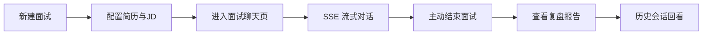
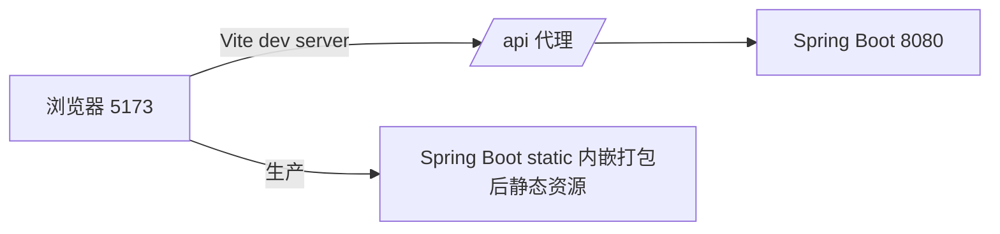
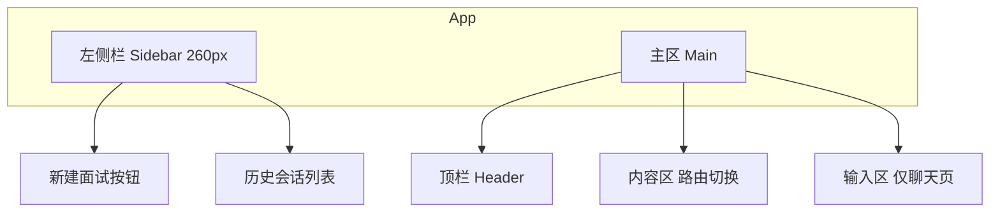
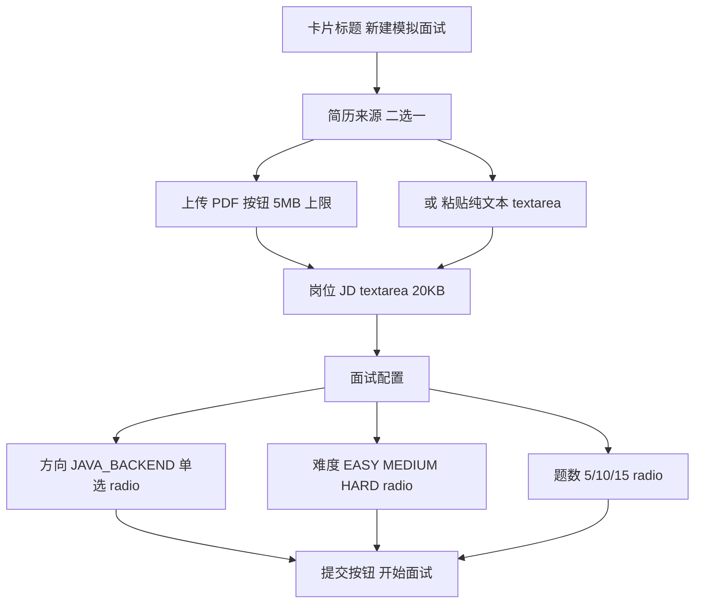
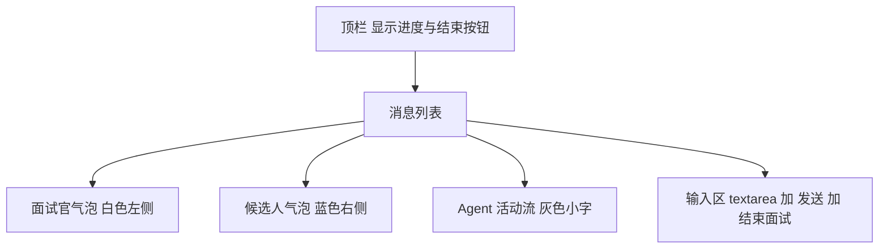

# AI 模拟面试平台 前端页面 优化方案

作者:Sakura | 创建时间:2026-10-29 22:35

承接《AI模拟面试平台-技术方案》第 7 节"Web 层：自写极简页面（对话流、简历上传、报告展示），SSE 流式渲染"，《AI模拟面试平台-接口文档》第 4 节接口清单。本方案只覆盖**前端工程**，对应开发步骤 7 中"REST 全套 SSE 与极简 Web 页面"的 Web 部分。视觉与交互风格沿用同机参考项目 `D:\travelScope\TravelScope\frontend`（React 19 + Vite + TypeScript + 纯 CSS、左侧栏 + 主聊天区 + SSE 流式气泡 + Agent 活动流）。

## 1 目标与边界

### 1.1 要做什么

为 AI 模拟面试平台搭建一个浏览器 WebUI，让用户完成面试的完整闭环：



页面清单（共 4 个主视图 + 1 个登录/令牌视图）：

1. **新建面试页** `/new`：上传/粘贴简历、粘贴 JD、选择方向/难度/题数，提交后跳转面试页
2. **面试聊天页** `/interview/:id`：核心页面，SSE 流式渲染面试官提问、用户作答、追问、换题，附带"结束面试"按钮
3. **复盘报告页** `/report/:id`：展示结构化评分（雷达图改表格版）、逐题回顾、改进建议
4. **历史会话列表** `/`：左侧栏形式的历史会话入口（沿用 travelScope 布局）
5. **令牌输入页** `/login`：输入 `APP_TOKEN` 存 localStorage（对应接口文档 Bearer体系（仅一个 `APP_TOKEN`）
- 不做移动端适配（只保证桌面 Chrome 正常）
- 不做华丽视觉（无插画、无渐变背景、无动效库）
- 不做语音作答、图片作答（P1 二期）
- 不做报告 PDF 导出按钮的实功能（P1 二期，仅留占位）

## 2 技术选型（与 travelScope 完全对齐，降低复制成本）

| 项 | 选型 | 说明 |
|---|---|---|
| 构建 | Vite 8 + TypeScript | 与 travelScope 同 |
| 框架 | React 19 + react-router-dom 7 | 与 travelScope 同 |
| Markdown | react-markdown + remark-gfm | 复用 travelScope 的 sanitize 逻辑 |
| 样式 | 纯 CSS（`App.css` 单文件） | 不引 Tailwind / antd，与 travelScope 一致 |
| HTTP | 原生 fetch + 手写 SSE 解析 | 复用 travelScope `parseSse`（接口文档明确要求 fetch 而非 EventSource） |
| 鉴权 | localStorage 存 `APP_TOKEN`，apiFetch 自动加 `Authorization: Bearer` | 复用 travelScope 的 auth.ts 模式 |
| 图表 | 不引库，评分用 CSS 表格 + 进度条替代雷达图 | 极简 |

工程位置：项目根新增 `frontend/` 子目录，与 `src/`（后端）平级。后端在 `resources/static/` 不放假前端，避免构建耦合；开发期 Vite 起 5173 端口，proxy 转发 `/api` 到 `http://localhost:8080`。



生产部署：`vite build` 产物拷到 `src/main/resources/static/`，由 Spring Boot 直接发静态文件，docker-compose 单容器即可演示。

## 3 信息架构

### 3.1 路由

```text
/login                令牌输入
/                     历史会话列表（左侧栏布局，主区显示空状态提示）
 状态）
*                     重定向 /
```

路由守卫 `RequireAuth`：未存 token 一律跳 `/login`。

### 3.2 页面骨架（沿用 travelScope 左右分栏）



**左侧栏（所有页共享）**：

- 顶部："＋ 新建面试" 虚线按钮（travelScope 的 `new-chat-btn`）
- 中部：会话列表，每项显示"方向 · 难度 · 创建时间 + 状态徽章"，点击跳转对应路由（IN_PROGRESS → /interview/:id；REPORTED → /report/:id）
- 底部：难度筛选下拉 + 退出登录（清 token）

**顶栏（主区顶部）**：

- 左侧：页面标题（"面试中 · Java 后端 · 中等难度 · 第 3/10 题"）
- 右侧：状态徽章 + 主操作按钮（聊天页为"结束面试"红色按钮，报告页为"查看消息记录"链接）

## 4 页面设计详述

### 4.1 新建面试页 `/new`

布局：主区居中卡片（约 720px 宽），纵向三段表单。



字段约束（对应接口文档 4.1）：

- 简历文本与 PDF 二选一，前端互斥禁用
- 提交后调 `POST /api/interviews` → 拿 `sessionId` → 立即调 `POST /api/interviews/{id}/start` → 跳 `/interview/:id`
- 失败时表单顶部红色错误替换语义：



**消息气泡类型**（映射接口文档 4.3 SSE 事件）：

| SSE 事件 | 前端渲染 |
|---|---|
| `message`（delta 累积） | 面试官气泡正文，流式追加 + 光标 `▌` |
| `action` type=QUESTION | 当前气泡前缀 badge：`📌 新题` |
| `action` type=FOLLOW_UP | 当前气泡前缀 badge：`🔁 追问` |
| `action` type=NEXT | 当前气泡前缀 badge：`➡️ 下一题` |
| `metrics` | 累积到气泡底部小字：`tokens: 1234 · 5.6s` |
| `done` | 关流，去光标，刷新左侧会话列表 |

**Agent 活动流**（沿用 travelScope `ActivityStream`）：面试页 P0 阶段事件较少（路由→Supervisor→面试官），但保留组件，事件类型用 travelScope 的 `agent_status` 同款协议（即便后端只发 1-2 条也保留折叠 UI）。

**顶栏右侧主按钮**：

- 状态为 IN_PROGRESS：红色"结束面试"按钮 → 确认对话框 → `POST /api/interviews/{id}/end` → 跳 `/report/:id`
- 状态为 ENDED（报告生成中）：黄色"报告生成中..."禁用按钮，3 秒轮询 `/api/interviews/{id}/report`，拿到 200 跳报告页

**底部输入区**：textarea 自动高度（2-6 行），Enter 发送、Shift+Enter 换行。streaming 时输入框禁用、按钮换成"停止"（调 abortRef 中断读流，与 travelScope 一致）。

### 4.3 复盘报告页 `/report/:id`

布局：主区滚动单列，宽度 860px 居中。

```mermaid
flowchart TB
    A[顶部 标题与元信息] --> B[综合评分卡]
    B --> C[四维评分明细表]
    C --> D[逐题回顾 手风琴列表]
    D --> E[改进建议 Markdown 块]
    E --> F[操作区 返回列表 加`scores.overall` / 10），配一句话结论（取自 `suggestions` 首条）
- **四维评分明细**：表格，行 = overall/technicalDepth/expression/followUpHandling，列 = 维度名 / 得分 / CSS 进度条
- **逐题回顾**：`items[]` 每题一个 `<details>` 手风琴：summary 显示题号+得分+题干截断 50 字，展开显示题干全文、用户答案摘要、面试官评语、单题得分
- **改进建议**：`suggestions` Markdown 列表（后端返回的就是 Markdown 字符串，直接用 `<Md>` 渲染）
- **元信息**：`tokenTotal`、`durationMs` 格式化为 `总耗时 12 分 30 秒 · 消耗 8,432 tokens`

**报告生成中兜底**：进入页面时若 `GET /report` 返回 `code: 202`，显示加载动画 + 3 秒轮询，直到拿到完整报告。

### 4.4 历史会话列表 `/`（左栏内嵌）

不单独成页，复用 travelScope 左栏 `conversation-list` 样式：

- 每项：`{direction} · {difficulty}` 一行 + `{createTime} · 状态徽章` 一行
- 状态徽章色板（travelScope 同款）：IN_PROGRESS 蓝 / ENDED 黄 / REPORTED 绿
- 点击：IN_PROGRESS → `/interview/:id`；REPORTED → `/report/:id`；ENDED → `/report/:id`（轮询兜底）
- 主区显示空状态插画（大字提示"点击左侧新建面试开始"）

### 4.5 令牌输入页 `/login`

travelScope 的 `login-card` 居中卡片：

- 标题"AI 模拟面试平台"
- 一个密码输入框 `APP_TOKEN`
- 提交后写入 localStorage，调 `GET /api/interviews?page=1&size=1` 验证 token 有效（401 则提示"令牌无效"），成功跳 `/`
- 页面底部小字提示："令牌从后端 `.env` 文件的 APP_TOKEN 复制"

## 5 状态与数据流

```mermaid
flowchart LR
    LS[localStorage token] --> AF[apiFetch 拦截器]
    AF -->|401| L[/login]
    AF -->|200| API[Spring Boot API]
    API --> SSE[SSE 流]
    SSE --> CP[InterviewPage state]
    CP --> UI[气泡渲染]
```

**前端本地状态**（无 Redux/Zustand，纯 useState）：

| 会话级，路由切换刷新 |
| `messages` | InterviewPage useState | 进入页面拉取 + SSE 增量 |
| `streaming` | InterviewPage useState | 单次 SSE 期间 true |
| `report` | ReportPage useState | 进入页面拉取 |

## 6 样式规范（沿用 travelScope 调色板）

| 变量 | 值 | 用途 |
|---|---|---|
| 侧栏底色 | `#1e2a3a` | 左栏 |
| 侧栏 hover | `#2a3a50` | 列表项 hover |
| 侧栏 active | `#34495e` | 列表项选中 |
| 主色 | `#3b82f6` | 用户气泡、主按钮、focus 边 |
| 危险色 | `#ef4444` | 结束面试、停止 |
| 成功色 | `#10b981` | REPORTED 徽章 |
| 警告色 | `#f59e0b` | ENDED 徽章 |
| 正文文字 | `#2c3e50` | 气泡文字 |
| 次要文字 | `#7d8ba1` | 时间戳、活动流 |
| 边框 | `#e5e8ef` | 气泡、卡片边 |
| 页面背景 | `#f5f6fa` | body |

字体：`'PingFang SC', 'Microsoft YaHei', -apple-system, sans-serif`（travelScope 同款）。

## 7 工程结构

```text
frontend/
├── index.html
├── package.json
├── vite.config.ts             代理 /api → 8080
├── tsconfig.json
└── src/
    ├── main.tsx
    ├── App.tsx                路由 + RequireAuth
    ├── App.css                全部样式 单文件
    ├── index.css              reset + 全局
    ├── types.ts               Interview/Report/SSE 类型
    ├── api/
    │   ├── auth.ts            token 存取 + apiFetch
    │   └── interview.ts       createInterview/start/chat/end/report/list
    ├── pages/
    │   ├── LoginPage.tsx
    │   ├── NewInterviewPage.tsx
    │   ├── InterviewPage.tsx  核心聊天页
    │   ├── ReportPage.tsx
    │   └── HistoryPage.tsx    空主区占位
    └── components/
        ├── Sidebar.tsx        左栏
        ├── MessageBubble.tsx  气泡+badge+metrics
        ├── ActivityStream.tsx Agent 活动流 沿用 travelScope
        └── ScoreBar.tsx       评分进度条
```

文件行数红线：单文件 ≤ 300 行（用户全局规则），InterviewPage 若超 300 行则把 SSE 事件 reducer 抽到 `api/interviewStream.ts`。

## 8 与后端接口的契约清单

| 前端调用 | 后端接口 | 何时 |
|---|---|---|
| `POST /api/interviews` | 接口文档 4.1 | 新建面试页提交 |
| `POST /api/interviews/{id}/start` | 4.2 | 新建成功后立即 |
| `POST /api/interviews/{id}/chat` SSE | 4.3 | 面试聊天页发送 |
| `POST /api/interviews/{id}/end` | 4.4 | 顶栏结束按钮 |
| `GET /api/interviews/{id}/report` | 4.5 | 报告页加载 + 轮询 |
| `GET /api/interviews?page=1&size=20` | 4.6 | 左栏列表 |
| `GET /api/interviews/{id}` | 4.7 | 报告页"查看消息记录" |

**SSE 协议约定**（前端必须实现的解析逻辑，与接口文档 4.3 对齐）：

- 用 `fetch` + `ReadableStream` 手写解析，不用 EventSource（带不了 Authorization 头）
- 一个事件块内多行: error` 显示在气泡尾部
- 中断：用户点"停止"→ 调 `reader.cancel()`

## 9 开发步骤拆分（前端部分）

| 步骤 | 内容 | 验证 |
|---|---|---|
| F0 | 工程初始化：Vite + React + TS，写 vite proxy，跑通 hello world | `pnpm dev` 打开空白页 |
| F1 | auth.ts + LoginPage + RequireAuth | 错 token 401，对 token 进首页 |
| F2 | Sidebar + HistoryPage（空态）+ 路由骨架 | 路由切换正常 |
| F3 | NewInterviewPage 表单 + 调通 create/start | 提交后跳到 /interview/:id |
| F4 | InterviewPage SSE 聊天（核心） | 完整跑一场 5 题面试 |
| F5 | ReportPage 报告渲染 | 结束面试看到完整报告 |
| F6 | 样式打磨 + 空态 + 加载态 + 错误条 | 走查 4 个页面 |
| F7 | `vite build` 产物集成到 Spring Boot static | 8080 端口直接访问页面 |

预计 F0-F3 一个开发会话，F4 单独一个会话（SSE 是最容易踩坑的），F5-F7 一个会话。

## 10 风险与待确认事项

1. **SSE 在浏览器中断恢复**：用户刷新页面时 streaming 状态丢失，需要进入页面时根据会话状态判断"是否正处于流式中"——P0 简化处理：刷新后视为非流式，消息以最后一条 `done` 为准（需用户确认）
2. **报告生成轮询频率**：3 秒一次会不会太频繁打到后端？建议第一版 3 秒，观察后调（需用户确认）
3. **雷达图**：是否坚持纯 CSS 进度条，还是引 `recharts` 画雷达图？引库 +50KB，效果更好（需用户确认）
4. **新建面试页简历 PDF 解析提示**：上传 PDF 后是否前端立刻显示 `resumeDigest`（接口文档 4.1 出参字段）让用户确认解析结果？建议显示一个折叠区（需用户确认）
5. **结束面试二次确认**：点"结束面试"是否弹 confirm？建议弹，误触成本高（建议默认弹）

## 11 验收清单

- [ ] 在 5173 端口完整跑通": 前缀泄漏（travelScope 踩过的坑）
- [ ] 停止按钮能立刻中断流式
- [ ] token 错误时所有页面跳 /login
- [ ] 历史会话点击能正确路由到 interview 或 report
- [ ] `vite build` 后由 Spring Boot 8080 直接服务，刷新任意路由不 404（history fallback 配置）
- [ ] 单文件不超过 300 行
- [ ] 浏览器控制台无 error 级别红字
