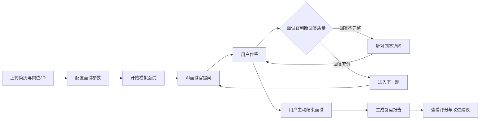
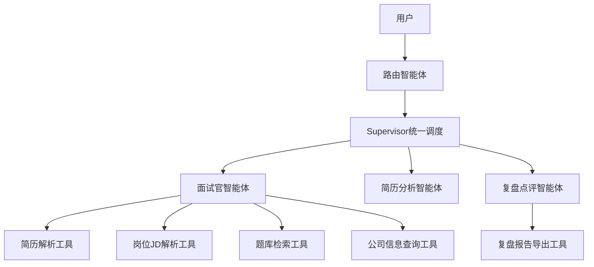
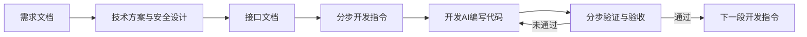

# AI 模拟面试平台 需求文档

作者:Sakura | 创建时间:2026-10-29

一句话说明这个项目：用户上传简历和目标岗位描述，多个 AI 智能体协作完成一场逼真的模拟技术面试，结束后输出结构化评分与复盘报告。

本文档回答"要做什么、给谁用、做到什么程度、明确不做什么"。技术实现细节由后续《技术方案》文档承接。

## 1 背景与目标

- 背景：求职者需要大量面试练习，真人陪练难约且贵；市面刷题类产品是单向问答，缺少针对个人简历的真实追问体验。
- 目标：构建一个多智能体模拟面试平台，AI 面试官能结合简历内容与目标岗位出题、追问，面试结束后给出多维评分和改进建议。
- 项目同时作为求职简历项目，要求：每个功能真实可演示、关键指标有实测数据、每个技术点经得起面试官追问。

## 2 用户与使用流程

目标用户：寻找实习或校招岗位的计算机专业学生。

## 3 功能需求清单

P0 为第一期必须项，缺任何一条主流程跑不通；P1 为二期增强；P2 明确不做，防止范围失控。

### P0 第一期必须

- [ ] 简历上传与解析：支持 PDF 与纯文本两种输入，Tika 提取原始文本后经 LLM 结构化清洗，产出技能、项目经历、教育背景等结构化信息
- [ ] 岗位 JD 输入：用户粘贴目标岗位描述文本
- [ ] 面试配置：选择岗位方向、面试题数、难度档位
- [ ] 题库检索模块 RAG：面试八股题库向量化存入 Milvus，采用关键词检索加向量相似度检索的混合召回
- [ ] 面试官智能体：结合简历、岗位 JD、检索到的题目进行提问，并根据用户回答质量决定追问还是下一题
- [ ] 路由智能体：将用户消息按意图分流到面试流程、闲聊、复盘流程
- [ ] 复盘报告：按评分维度输出结构化评分、逐题回顾、改进建议
- [ ] 会话管理：长面试对话的上下文压缩，面试历史记录保存与查看

### P1 第二期增强

- [ ] 公司信息查询工具：结合目标公司出题
- [ ] 复盘报告导出 PDF
- [ ] 语音作答与语音转文字
- [ ] 候选人图片作答：支持架构图、代码截图、报错截图上传，面试官基于 VL 模型看图点评
- [ ] 简历视觉解析：对文本提取质量差的 PDF（双栏排版、扫描件），页面转图片走 VL 视觉解析

### P2 明确不做

- 多租户企业版、用户注册登录体系之外的复杂权限
- 移动端
- 对接真实招聘平台
- 华丽的自定义前端界面

## 4 非功能需求

### 4.1 安全需求

- 模型 API 密钥只能通过环境变量或本地配置文件注入，严禁硬编码、严禁提交到代码仓库
- 用户简历属于敏感个人数据：日志输出必须脱敏，存储需加密方案（技术方案阶段细化）
- 用户输入做长度与格式校验，防御提示注入攻击（面试场景天然存在注入动机，例如用户诱导面试官放水，需要设计与对抗）
- 接口必须有鉴权，防止匿名调用刷接口消耗模型费用
- 第三方接口调用全部经过服务端，浏览器端不接触任何密钥

### 4.2 性能与可观测

- 面试单轮问答响应时间目标 P95 小于 8 秒
- Prometheus 采集指标：QPS、接口延迟、Token 消耗、题库召回命中率

### 4.3 部署

- 第一期部署在本机，无公网暴露；Docker Compose 一键启动全部组件，供演示与面试官复现

## 5 智能体与工具划分

- 路由智能体：识别用户意图，分流转发，不生成面试内容
- 面试官智能体：核心角色，出题、追问、控制面试节奏
- 简历分析智能体：面试开始前解析简历，产出结构化简历信息供面试官使用
- 复盘点评智能体：面试结束后评分并生成复盘报告
- 五类业务工具按统一规范注册，带调用日志与异常兜底

## 6 文档与开发流程

本项目采用方案架构师模式协作：AI 架构师负责文档与开发指令，开发 AI 负责代码实现，用户负责确认与验收。

- 接口文档由开发阶段按统一模板产出，不手写重复劳动
- 每段开发指令只做一件事，做完验证通过再进入下一步，避免大爆炸式开发

## 7 已确认事项（2026-10-29 用户确认）

1. 第一期交互形态：前后端分离，后端只提供 REST 与 SSE 接口；前端为 React 加 Vite 独立工程（仓库 frontend 目录），由前端开发独立分支开发、与后端分别提交，页面保持极简（2026-10-29 二次确认）
2. 岗位范围：第一期仅支持 Java 后端方向
3. 部署环境：本地电脑，Docker Compose 演示，无公网暴露
4. 模型 API：用户自行注册阿里云百炼获取 DashScope 密钥，免费额度优先，超出后按量付费；密钥通过环境变量注入，不进代码仓库
5. 单轮响应 P95 小于 8 秒目标保留，技术方案阶段结合实测校准
