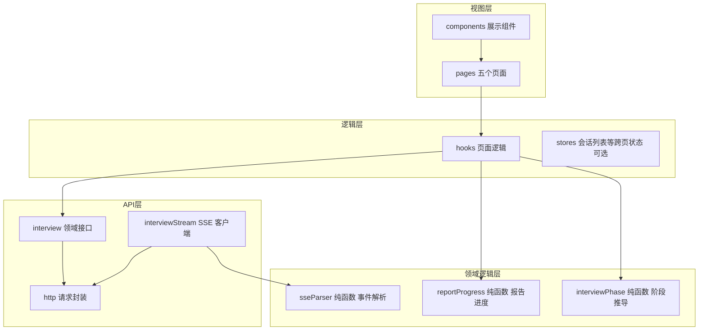
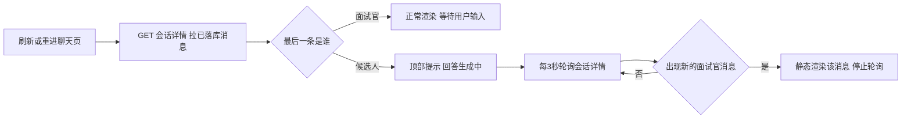

# AI 模拟面试平台 前端架构 优化方案

作者:Sakura | 创建时间:2026-10-30 18:22

本文承接《AI模拟面试平台-前端页面-优化方案》（页面清单、视觉定稿、路由设计全部沿用，不重述），补充其未覆盖的**工程架构**：API 层、SSE 流式层、状态管理、测试策略。参考来源：novel-agent 前端（Vue 3 加 TypeScript，API 封装与事件驱动状态机值得学）与 travelScope 前端（React 同栈参照）。我们保持 React 19 技术栈不变。

## 1 文档定位与边界

- 做什么：定义前端代码分层、模块职责、SSE 处理规范、测试策略
- 不做什么：页面视觉（见前端页面方案第 6 节定稿）、接口契约（见接口文档）、后端实现
- 单文件 300 行红线不变，超限即拆分

## 2 工程分层



分层规则（学 novel-agent）：

- **领域逻辑层必须是纯函数**：输入事件与状态、输出推导结果，不碰 DOM 不发请求，可单测
- **API 层是唯一出口**：页面与组件禁止直接 fetch
- **hooks 持有可变状态**：SSE 生命周期、消息列表、流式状态全部收在 hook，不散落组件

## 3 API 层设计

`src/api/http.ts` 单一请求封装（学 novel-agent api.ts 的轻量做法，不引 axios）：

- 自动附 `Authorization Bearer` 头，token 读 localStorage
- 非 2xx 抛 `ApiError`（带 status），401 统一跳 `/login`，其余由调用方展示
- 统一解包响应体 `data` 字段

`src/api/interview.ts` 领域方法与接口文档一一对应：

| 方法 | 接口文档 | 何时用 |
|---|---|---|
| createInterview | 4.1 | 新建面试提交 |
| startInterview | 4.2 | 新建成功后 |
| streamChat | 4.3 | 聊天页发送回答 |
| endInterview | 4.4 | 顶栏结束按钮 |
| getReport | 4.5 | 报告页加载与轮询 |
| listInterviews | 4.6 | 左栏列表 |
| getInterviewDetail | 4.7 | 刷新恢复与消息记录 |

## 4 SSE 流式层设计（核心）

### 4.1 解析器纯函数

`src/lib/sseParser.ts`：输入累计字节流文本，输出已完整的事件数组与剩余缓冲。规则：

- 事件块以空行分隔，一个块内多个 `data:` 行按换行 join 拼接（travelScope 踩坑：漏拼接会把字面 `data:` 渲染进正文）
- 返回 `{ events, rest }`，调用方把 rest 留到下个 chunk 继续拼
- 此文件必须有 vitest 单测覆盖：正常流、一 chunk 半条事件、多 data 行、error 事件

### 4.2 流客户端

`src/api/interviewStream.ts`：fetch 加 ReadableStream 手写循环（不用 EventSource，带不了鉴权头，接口文档第 1 节既定）。事件顺序 `message → action → metrics → done`，异常时后端发 `error` 事件，气泡尾部红条提示。

| 场景 | 行为 |
|---|---|
| 流式中 | textarea 禁用，发送按钮变红色停止 |
| 点停止 | AbortController 中止 fetch，本轮视为用户放弃，后端照常落库已生成部分 |
| error 事件 | 气泡尾红条，输入框恢复，允许重发 |
| fetch 网络异常 | toast 提示，允许重发同一条回答 |

停止按钮的后端协作取消（novel-agent 的 interrupt 模式）P0 不做：单轮流式 P95 目标 8 秒内，abort 断连后服务端写完即止，成本可忽略。

### 4.3 刷新恢复（回答前端页面方案待确认事项 1）

推荐方案：**刷新后从会话详情恢复，进行中那轮降级为轮询**。



不做流式续传（Last-Event-ID 式恢复）：那需要后端维护事件日志表，对单轮流式收益不成比例。轮询兜底最多多等 3 秒。（需用户确认）

## 5 面试阶段状态机（学 novel-agent task-phase）

`src/lib/interviewPhase.ts` 纯函数：从当前消息列表与 SSE 事件流推导 UI 状态：

```text
输入  消息列表  累积的 action 事件
输出  当前题号  当前动作 QUESTION 或 FOLLOW_UP 或 NEXT  流式状态
用途  顶栏 第 3/10 题  气泡徽章 第 N 题 追问 下一题  输入区禁用态
```

要点：推导规则集中在一个文件，配 vitest 单测（例如 action 乱序到达、done 缺失时的容错），组件只消费结果不做判断。

## 6 报告轮询与分步进度（学 novel-agent 阶段推导）

`src/lib/reportProgress.ts` 加 `useReportPolling` hook：

- 进入报告页：GET /report 返回 202 即开始轮询，3 秒间隔，连续 5 次后退避到 10 秒封顶，拿到完整报告停止
- 生成中的分步进度文案（消息汇总 → 逐题评分 → 生成建议 → 汇总输出）由轮询次数推导显示阶段，P0 不依赖后端真实阶段字段（后端架构文档待确认事项 3 保持一致）
- `reportProgress.ts` 的轮询节奏与阶段推导为纯函数，可单测

（3 秒轮询与假进度文案两个点需用户确认，对应前端页面方案待确认事项 2）

## 7 状态管理

不引 Redux/Zustand。分工：

| 状态 | 归属 |
|---|---|
| token | localStorage，http.ts 读写 |
| 会话列表 conversations | 左栏组件 state，路由切换时刷新 |
| 消息列表与流式状态 | useInterviewStream hook（InterviewPage 专属） |
| 报告数据 | useReportPolling hook（ReportPage 专属） |
| 表单状态 | 各页面 useState |

useInterviewStream 职责边界：发送、SSE 订阅与清理、停止、刷新恢复轮询、消息列表维护。若超 300 行，把恢复轮询拆为 useRoundRecovery hook。

## 8 测试策略

单人团队可承受的最小集（novel-agent 前端即此规模）：

- [ ] vitest 单测只写纯函数：sseParser、interviewPhase、reportProgress
- [ ] Playwright 一条 e2e 主流程：登录 → 新建面试（粘贴简历文本）→ 答 2 题 → 结束 → 看到报告骨架
- [ ] CI 不强求，本地 `npm test` 与 `npm run e2e` 手动跑，纳入 F6 验收

## 9 工程结构（修订版）

在前端页面方案第 7 节目录树上增量：

```text
frontend/src/
├── api/
│   ├── http.ts               请求封装 ApiError 鉴权
│   ├── interview.ts          领域接口 七个方法
│   └── interviewStream.ts    SSE 流客户端
├── lib/                      纯函数 全部可单测
│   ├── sseParser.ts
│   ├── interviewPhase.ts
│   └── reportProgress.ts
├── hooks/
│   ├── useInterviewStream.ts 聊天页核心
│   └── useReportPolling.ts   报告页
├── pages/                    五个页面 不变
├── components/               四个组件 不变
└── types.ts                  类型定义
├── tests/                    Playwright e2e
```

与旧版差异：api 目录细分三文件、新增 lib 与 hooks 两层、新增 tests。F0-F7 步骤拆分不变，F4 的实现按本架构执行。

## 10 待确认事项汇总

1. 刷新恢复采用"会话详情恢复加进行中轮询降级"（4.3 节，需用户确认）
2. 报告轮询 3 秒起步退避封顶 10 秒、分步进度为推导式假进度（6 节，需用户确认）
3. resumeDigest 折叠确认区、结束面试 confirm 弹窗两个旧遗留项仍待确认（前端页面方案第 10 节）
