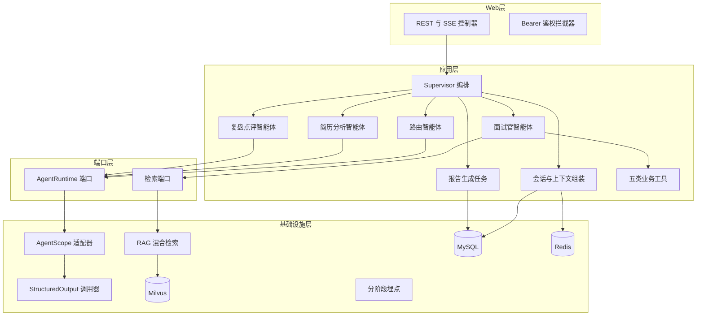
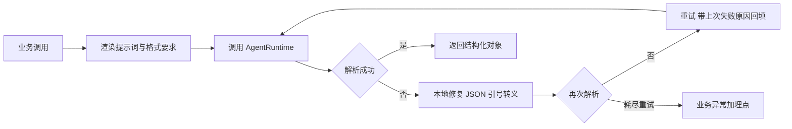
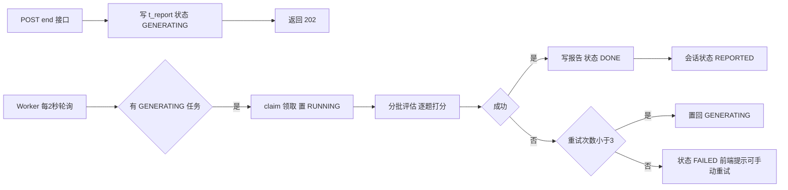

# AI 模拟面试平台 后端架构 优化方案

作者:Sakura | 创建时间:2026-10-30 18:22

本文承接同目录《AI模拟面试平台-需求文档》《AI模拟面试平台-接口文档》，是后端实现架构的修订版。它整合了三个参考项目的调研结论，与 2026-10-29《技术方案》的关系：模块划分、存储选型、S0-S9 步骤骨架不变，本文细化实现架构并升级若干设计，冲突处以本文为准。

## 1 调研结论对照

| 参考项目 | 技术路线 | 我们吸收的 |
|---|---|---|
| travelScope | AgentScope-Java 2.0.3 | AgentScope API 用法参照（步骤 2 与 4 的开发指令引用） |
| interview-guide | Spring AI 2.0 | 结构化输出调用器、Prompt 安全分层、分阶段埋点、评估分批与降级、查询改写、历史题去重、防误触付费 |
| novel-agent | AgentScope-Java 2.0.1 六边形架构 | AgentRuntime 端口与适配器、智能体权限收敛、角色分模型、MySQL 任务队列与 Worker、协作式取消、上下文分层组装、FakeAgentRuntime 测试法 |

## 2 分层架构总览

单 Maven 模块内的包边界即架构边界，不拆多模块（单人团队规模）。核心升级：智能体引擎通过端口隔离，应用层不直接依赖 AgentScope 类。



### 2.1 架构风格决策 为什么不是 DDD 与经典三层（2026-10-31 补记）

DDD 的适用前提是领域复杂度：多个限界上下文、聚合上的不变量、业务规则频繁演变。本项目领域只有一个面试会话上下文、三张表，唯一的领域规则是状态机 CREATED 到 REPORTED 的流转校验，撑不起聚合根与领域服务那套仪式感；简历上写 DDD 反而会在"你的聚合根是什么"上被问穿。经典三层则假设复杂度在数据库访问，而本项目的复杂度在四类外部系统的集成隔离（模型引擎、Milvus、Redis、MySQL），大 Service 类会把编排与模型调用糊在一起，也表达不了 FakeAgentRuntime 这种引擎可替换的测试价值。

结论：三层的骨架加六边形的端口（即第 2 节分层），并白拿 DDD 三个零成本战术件：

- 领域对象保持无框架依赖的纯数据结构（SessionConfig、ReportScore、InterviewReport），不让 Spring 注解爬上去
- 会话状态机集中一处显式实现，非法流转统一抛 409，不散落在各控制器
- 统一语言：文档与代码术语一致（会话、轮次、复盘）

面试口径：做过领域分析后判断只有一个面试会话限界上下文、唯一不变量是状态机，没有 DDD 战略模式的发挥空间；复杂度在智能体引擎与检索存储的集成隔离上，因此选分层加端口适配器，FakeAgentRuntime 换来编排逻辑零成本的单元测试，换引擎只动 infra 一个类。

## 3 智能体运行时端口（来自 novel-agent）

### 3.1 端口定义

`agent` 包内定义接口，`infra` 包内用 AgentScope 实现：

```text
AgentRuntime 端口
  Flux<AgentOutput> generate 角色 会话id 系统提示词 用户输入
  void interrupt 会话id
  String modelName 角色
```

价值：编排逻辑只依赖端口，换引擎只换 `infra` 一个类；更关键的是测试——写一个 FakeAgentRuntime 返回预设流，Supervisor 与智能体逻辑的单测完全不调真实模型（novel-agent 的 607 行集成测试全靠这个方法跑通全流程）。

### 3.2 智能体权限收敛

AgentScope HarnessAgent 提供能力开关，全部业务智能体统一收敛：禁文件系统、禁 shell、禁子智能体、禁动态技能。差异只在迭代次数与工具：

| 智能体 | 调用形态 | maxIters | 工具 |
|---|---|---|---|
| 路由 | 单次结构化输出 | 1 | 无 |
| 简历分析 | 单次结构化输出 | 1 | 无 |
| 面试官 | ReAct 多轮 | 3 | 题库检索工具 |
| 复盘点评 | 单次结构化输出 | 1 | 无 |

面试官保留 ReAct 与检索工具是本项目与 interview-guide 的核心差异：它的题目是一次性预生成的静态清单，我们是按回答动态决定追问或换题。

### 3.3 角色分模型（来自 novel-agent 的分角色模型表）

| 用途 | 模型 | 理由 |
|---|---|---|
| 路由意图分类 | qwen-turbo | 轻量分类任务 |
| 查询改写 | qwen-turbo | RAG 前置高频调用 |
| 上下文摘要压缩 | qwen-turbo | 高频低难度 |
| 简历结构化清洗 | qwen-plus | 一次性、要质量 |
| 面试官出题与追问 | qwen-plus | 核心体验 |
| 复盘评分 | qwen-plus | 核心产出 |
| 向量化 | DashScope Embedding | 题库入库 |

熔断降级链保持原方案：qwen-plus 失败降级 qwen-turbo（步骤 8）。本表为正式口径；开发期模型源经 MODEL_PROVIDER 切智谱 GLM 或本地 Ollama（OpenAI 兼容接入，档位映射见 2026-10-31 模型Provider接入方案），不影响本表。

## 4 StructuredOutput 调用器（来自 interview-guide）

全部需要 JSON 输出的调用走统一组件，禁止业务代码各写各的解析：



- 重试默认 3 次，重试提示词附上次解析失败摘要（interview-guide 实测有效）
- 使用位置：路由意图分类、简历结构化清洗、复盘逐题评分、查询改写（可选）
- 埋点：调用数、失败数、耗时，按调用方打标签

## 5 会话与上下文组装（融合两项目）

双层存储不变（Redis 活跃会话 TTL 24 小时加 MySQL 全量落库）。升级上下文组装为显式分层（参考 novel-agent ContextAssembler）：

```text
上下文输入 = 简历结构化要点 常驻不压缩
           + 岗位 JD 要点 常驻
           + 已问题目与已给评价 近K轮原文
           + 窗口外历史摘要 qwen-turbo 生成
           + 本轮 RAG 检索题目 topK
预算控制 = 总字符上限 超限先压检索题 再压历史原文
```

- 摘要结果缓存 Redis（`ctx:summary:{id}`），轮次未越界不重算
- 长文本截断采用首尾保留式压缩（保留开头一半加结尾一半，中间标注已压缩），比硬截断保留更多语义

## 6 复盘报告任务化（来自 novel-agent 任务队列模式）

替代原方案"异步线程池生成报告"，改用 MySQL 任务表加轮询 Worker，进程重启不丢任务：



- Worker 单并发（本地单用户，报告无并行需求），虚拟线程执行
- 应用启动时恢复：把残留 RUNNING 重置为 GENERATING
- 评估分批与降级规则（来自 interview-guide 统一评估引擎）：主问题与其追问为不可拆分组；批次失败按组二分重试且设预算上限；最终失败的题显式标注"系统降级按 0 分"，不伪装真实评分
- 接口契约不变：`GET /report` 生成中返回 202，前端轮询

## 7 RAG 检索升级（来自 interview-guide）

混合召回骨架不变（Milvus 稀疏加稠密、RRF 融合、入库幂等、Embedding 缓存）。新增三件事：

- [ ] 查询改写：检索前用 qwen-turbo 把口语化出题查询改写为检索友好形式，失败自动回退原查询，改写与原始双查询命中结果按最大相似度融合
- [ ] 按查询长度分档：短查询用小 topK 加高阈值，长查询用大 topK，参数进配置
- [ ] 出题去重：面试官出题提示词注入本会话已问题目摘要清单，要求不重复考察

## 8 安全设计升级

原方案第 4 节的密钥管理、Bearer 鉴权、输入校验、日志脱敏全部保留。Prompt 注入防护从"声明式"细化为可实现的机制（来自 interview-guide）：

- 用户文本入库前过滤：行首角色伪造（system 冒号等）、常见注入短语中英文模式、伪造分隔符
- 简历、JD、检索结果拼进提示词时用随机 UUID 边界标签包裹，攻击者无法预构造越界标签
- 面试官系统提示词保留角色锁定声明，两者叠加
- 智能体权限收敛见 3.2 节，工具返回内容以数据块拼装不与指令混排（原方案要求不变）

## 9 可观测升级

埋点从"接口级"细化为"阶段级"（来自 interview-guide RagMetrics）：

```text
每轮 chat 记录  意图分类耗时  检索耗时  生成耗时  总耗时  各自 timer 加成功失败标签
结构化输出记录  调用数  重试数  耗时  按调用方标签
RAG 记录  命中数  改写命中与原始命中分桶
报告任务记录  排队时长  生成时长  重试次数
```

Prometheus 暴露与 Grafana 面板仍属步骤 8。评测脚本加 `RUN_RAG_EVAL` 环境变量开关，未显式开启不触发付费调用。

## 10 开发步骤映射

步骤骨架与验证方式沿用技术方案第 8 节，增量如下：

| 步骤 | 本次架构新增内容 | 增量验证 |
|---|---|---|
| 2 RAG | 查询改写、长度分档、双查询融合 | 三条测试查询对比改写前后命中 |
| 4 编排 | AgentRuntime 端口化重构、权限收敛、路由结构化输出 | FakeAgentRuntime 单测通过；三种意图分流正确 |
| 5 会话 | 分层上下文组装、首尾保留压缩 | 超窗口后输入 token 下降日志 |
| 6 报告 | 任务表加 Worker、分批评估、显式降级 | kill 进程重启后报告继续生成；构造失败题看降级标注 |
| 8 稳定性 | 分阶段埋点 | Grafana 出阶段耗时面板 |
| 9 评测 | RUN_RAG_EVAL 防误触 | 混合召回对比报告 |

## 11 与旧文档的差异与待确认事项

1. 复盘生成由"线程池异步"改为"MySQL 任务表加 Worker"，会话状态机不变（需用户确认）
2. `t_report` 表增加状态与重试次数字段，属增量 DDL（需用户确认）
3. 面试 chat 的 SSE 协议不变；报告 202 响应可选增加阶段字段供前端展示分步进度，暂不做（需用户确认）
4. 查询改写每次检索多一次 qwen-turbo 调用，成本影响微小（需用户确认）

## 12 明确不做

微服务拆分、多租户、语音面试、Redis Stream 消息队列（单人团队用不上，MySQL 任务表已覆盖报告场景）、interview-guide 式多 Provider 管理页、PDF 导出、S3 对象存储。
