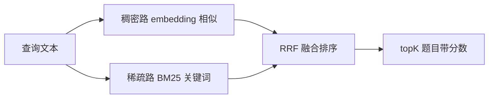

# AI 模拟面试平台 开发指令 步骤 2

作者:Sakura | 创建时间:2026-10-31 15:05（方案架构师产出，交开发 AI 执行）

## 你的角色与边界

你是本项目的开发执行 AI。按本指令实现步骤 2，不做方案外发挥。遇到方案未覆盖的技术决策，停下来问用户。

## 必读文档（按顺序）

1. `plans/2026-10-29/AI模拟面试平台-技术方案.md` 第 3.1 节 RAG 模块、第 8 节步骤表
2. `plans/2026-10-30/AI模拟面试平台-后端架构-优化方案.md` 第 7 节 RAG 升级、第 10 节步骤 2 增量
3. `plans/2026-10-31/模型Provider接入-优化方案.md` provider 切换设计（步骤 1 已实现）

## 前置核验结论（2026-10-31 架构师完成，全部 javap 本地仓库 jar，不必重复核验）

- AgentScope 的 RAG 能力在 `agentscope-extensions-rag-simple:2.0.3` 中，其中提供 `io.agentscope.core.rag.store.MilvusStore`，但其检索为**纯稠密单路**（SearchDocumentDto 仅含 vectorName、queryEmbedding、limit、scoreThreshold，无稀疏向量与融合）
- 因此**混合检索按原方案自封装**：直接编码于 `io.milvus:milvus-sdk-java:2.6.17`（rag-simple 的传递依赖，本地仓库已有，与服务端 milvus v2.6.1 匹配）
- EmbeddingModel 三路实现随 rag-simple 提供，直接复用不自研（Builder 签名已核验）：
  - `DashScopeTextEmbedding.Builder`：apiKey、modelName、dimensions、baseUrl
  - `OpenAITextEmbedding.Builder`：apiKey、modelName、dimensions、baseUrl
  - `OllamaTextEmbedding.Builder`：baseUrl、modelName、dimensions
- 接口 `io.agentscope.core.embedding.EmbeddingModel`：`Mono<double[]> embed(ContentBlock)`、`getModelName()`、`getDimensions()`
- 本步骤不使用 `SimpleKnowledge`、`KnowledgeRetrievalTools`、`RetrieveConfig`（步骤 3、4 再评估是否包装）

## 本次任务：只做步骤 2，按 2a → 2b → 2c 顺序

禁止实现：REST 接口、智能体编排、题库检索工具注册（步骤 3）、出题去重（步骤 4 提示词）、Redis Embedding 缓存（步骤 5）、评测脚本（步骤 9）。

### 2a 题库种子、解析与幂等入库

**题库文件**：新建 `backend/question-bank/java-backend.md`，种子至少 15 题，覆盖集合、并发、JVM、MySQL、Redis、网络、Spring 七个方向，题目间主题差异要明显（便于人工判断召回相关性）。格式严格如下：

```markdown
## QB-001
题干：HashMap 在 Java 8 之后的底层结构是怎样的？
要点：数组加链表加红黑树；链表长度超过 8 且数组长度达到 64 才树化；负载因子 0.75
标签：Java集合,HashMap
来源：个人笔记
```

**代码**：

- `rag/BankQuestion`：record（id、question、points、tags、source），附 `searchText()` 方法返回 题干加要点加标签 拼接文本
- `rag/QuestionBankParser`：解析上述 Markdown 为 `List<BankQuestion>`，格式非法即抛异常带题号
- `infra/EmbeddingModels`：与 ChatModels 同构的 embedding 工厂，复用同一个 `MODEL_PROVIDER` 开关分派三路；模型名经新环境变量读取，默认值：dashscope 与 openai 均为 `text-embedding-v3`，ollama 为 `nomic-embed-text`
- `rag/MilvusQuestionStore`：基于 milvus-sdk-java 2.6.17 自封装，职责：
  - 集合 schema：id（VarChar 主键）、question、points、tags、source（VarChar）、search_text（VarChar，BM25 输入字段）、sparse（SparseFloatVector，BM25 函数输出）、dense（FloatVector，维度取 `EmbeddingModel.getDimensions()`，当前 text-embedding-v3 为 1024）
  - 幂等入库：导入前按 id 批量查询，已存在则跳过并打印跳过数；`--rebuild` 参数先删集合再建再全量导入
  - 注意：换 embedding 模型（维度不同）必须 `--rebuild`，在代码注释与 CLI 输出中提示
- **两处需查官方文档确认再写**（不凭记忆猜，项目纪律）：BM25 Function 的中文 analyzer 配置（Milvus 2.6 文档，analyzer 需用中文分词，standard 对中文无效）；HybridSearch 的请求类与 RRFRanker 的准确类名（用 javap 核对本地 2.6.17 jar：`javap -cp <milvus jar> io.milvus.v2.service.vector.request.HybridSearchReq` 等）

### 2b 混合检索



- `rag/MilvusQuestionStore.search`：dense 一路用 COSINE 度量，sparse 一路走 BM25，`RRFRanker` 融合，返回 topK 与各路分数
- `rag/RagCliRunner`：命令行入口，子命令 `import`（解析入库，打印入库数与跳过数）与 `search`（打印 topK 的题号、题干、总分、稠密分、稀疏分）；search 支持 `--dense-only` 开关只走稠密路，供人工对比
- 运行方式：`mvn compile exec:java -Dexec.mainClass=com.liuzihe.interview.rag.RagCliRunner -Dexec.args=...`

### 2c 查询改写与长度分档（2a、2b 验证通过后再做）

- `rag/QueryRewriter`：用 `ChatModels.chat()` 把口语化查询改写为检索友好形式，调用失败回退原查询，不改写时不额外消耗
- 双查询融合：原始与改写各跑一次混合检索，按题号去重后取并集按分数排序截 topK
- 长度分档：查询短于 12 字符用 topK 3 且分数阈值 0.5，否则 topK 5 阈值 0.3；参数先做成常量类，进配置留给后续步骤

## 环境变量新增（EnvKeys 与 .env.example 同步补齐）

```text
OPENAI_EMBEDDING_MODEL=text-embedding-v3
DASHSCOPE_EMBEDDING_MODEL=text-embedding-v3
OLLAMA_EMBEDDING_MODEL=nomic-embed-text
MILVUS_URI=http://localhost:19530
MILVUS_COLLECTION=question_bank
```

开发期当前 provider 为 openai（中转站），其中转站模型列表已确认含 text-embedding-v3。

## 验证方式（全部通过才算完成）

1. `docker compose up -d milvus`（etcd、minio 自动带起），milvus 容器 healthy
2. `import` 种子题库：首次全部入库；**立即重跑一次**，输出跳过数等于题目总数（幂等）
3. 三条测试查询人工确认相关性，例如：HashMap 扩容、索引失效场景、volatile 作用——期望命中对应主题题目且排前
4. 同一查询 `--dense-only` 对比混合检索，观察稀疏路是否补回了稠密路漏掉的题
5. 2c 完成后：口语化查询（如"集合类哪个不安全"）对比改写前后命中
6. `mvn -q compile` 通过；`git grep "sk-"` 无结果；`git status` 看不到 `.env`
7. 单文件不超过 300 行，超限即拆分
8. 验证通过后 commit：`step2: 题库入库与混合检索`（提交到 main 分支；若工作区当时不在 main，用临时 worktree 方式，勿直接切分支——仓库可能有多会话并行）
9. 完成后在 `.agentdocs/code-changes/2026-10-31/` 新建 `AI模拟面试平台-步骤02-实现.md`，记录做了什么、问题与解决、验证命令输出摘录
