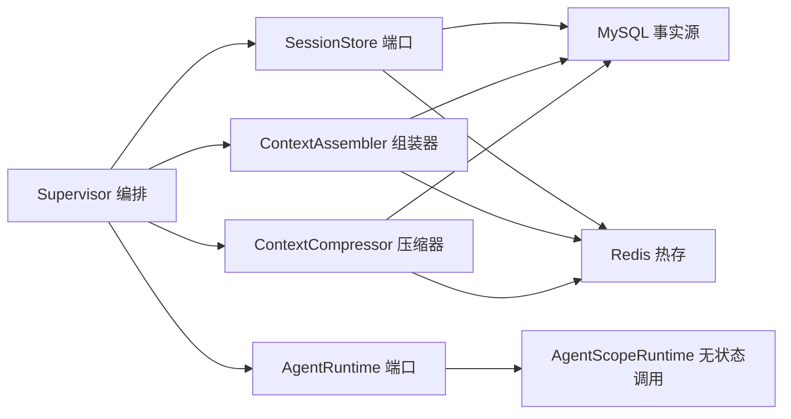
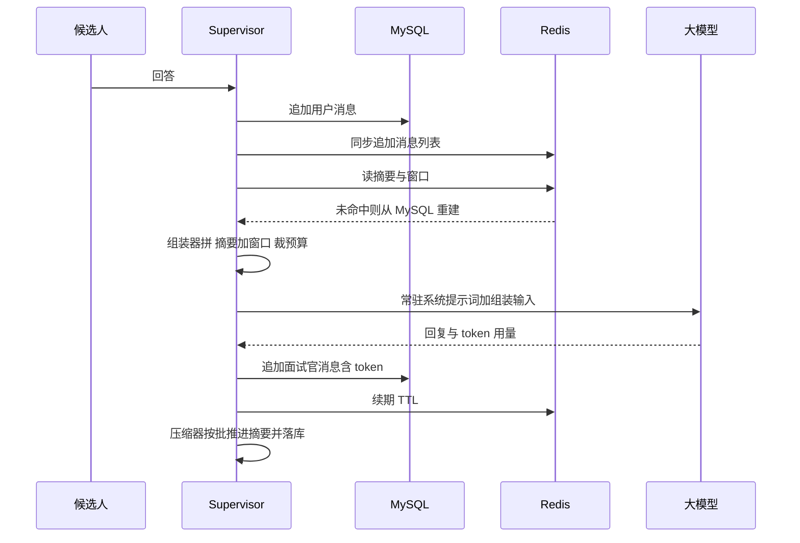

# AI 模拟面试平台 开发指令 步骤 5

作者:Sakura | 创建时间:2026-10-31（方案架构师产出，交开发 AI 执行）

## 你的角色与边界

你是本项目的开发执行 AI。按本指令实现步骤 5：会话持久化与上下文优化。不做方案外发挥；遇到指令未覆盖的技术决策，停下来问用户。

## 必读文档

1. `.agentdocs/plans/2026-10-30/后端架构-优化方案.md` 分层上下文组装部分（本步架构依据）
2. `.agentdocs/code-changes/2026-10-31/AI模拟面试平台-步骤04-实现.md`（现状基线）
3. 本文档全文

## 背景：失忆从哪来

当前记忆依赖 `AgentScopeRuntime` 里按角色会话缓存的 `InMemoryAgentStateStore`，AgentScope 每轮自动把全部历史塞进模型输入。三个后果：

1. **线性膨胀**：单轮输入 token 随轮数增长，50 轮约 2 万 5 千 token，成本延迟持续上升
2. **窗口溢出**：超出模型上下文窗口后调用报错或静默截断头部，即失忆
3. **进程失忆**：重启即全丢，内存态没有任何恢复手段

目标：支撑单场 40 到 60 轮（按面试节奏约 1 小时）连续对话，单轮输入 token 稳定在 6 到 8 千，进程重启后可无损恢复继续面。本机制与轮数无关，100 轮也不膨胀。

## 竞品对标结论（机制吸收，代码零拷贝）

已通读 JavaGuide 作者的 interview-guide 语音面试模块，它有一套生产级的上下文压缩机制。吸收 7 项机制：

1. **滑动窗口加增量摘要**：最近窗口保留原文，窗口外的消息攒够一批才触发一次摘要合并，不是每轮摘要
2. **滚动合并式摘要**：新一批与旧摘要合并产出新摘要，保留关键事实不编造
3. **字符硬预算兜底**：摘要加窗口超预算时从最早删起，永远保住最近消息；纯代码逻辑，不依赖模型行为
4. **摘要边界持久化**：coveredSeq 单调递增并落库，重启后不重复摘要
5. **降级不回退全量**：摘要模型失败时沿用旧摘要或退化为仅窗口模式，绝不把全量历史塞回模型
6. **读路径有界**：单轮最多读窗口加一个摘要批次，不全量扫库
7. **先库后缓存**：数据库是事实源先写，缓存写失败可容忍、可从库重建

不抄 4 项：

1. **任何代码与提示词文本零拷贝**——竞品 AGPL 3.0 许可，拷贝会污染本仓库许可，机制可以学，文字必须自己写
2. 悲观锁防边界回退——我们单进程单写者，无并发场景
3. Redis Stream 任务队列——本步不需要队列，复盘异步化属步骤 6 再定
4. 简历全文每轮重读——我们已有 resumeDigest，比它更省

## 总体设计



每轮模型输入公式（取代 AgentScope 自动累积）：

- **系统提示词常驻层**（每轮重建，已有）：角色锁定、行为规则、简历要点、岗位要求、已问题目清单
- **用户输入组装层**（本步新增）：前情摘要，若存在 ＋ 最近 WINDOW 条消息原文 ＋ 硬预算裁剪

参数默认值（`ContextAssembler` 常量集中定义）：

| 参数 | 默认值 | 说明 |
|---|---|---|
| WINDOW_MESSAGES | 20 | 窗口内消息数，约 10 轮问答原文 |
| SUMMARY_BATCH | 10 | 窗口外未覆盖消息攒够此数触发一次摘要 |
| MAX_CONTEXT_CHARS | 8000 | 摘要加窗口总字符预算 |
| MAX_SUMMARY_CHARS | 2500 | 单份摘要上限 |

已问题目清单防膨胀：单条摘要上限从 100 字降到 60 字，只保留最近 40 条（更早的由滚动摘要覆盖，摘要提示词明确要求保留已问话题）。

## 存储设计

### MySQL 事实源（本地 8.0.16，3306）

DDL 放 `backend/src/main/resources/sql/session-schema.sql`，由 init-db 子命令执行，库不存在则建：

```sql
CREATE TABLE IF NOT EXISTS t_session (
  session_id          VARCHAR(36) PRIMARY KEY,
  resume_digest       TEXT NOT NULL,
  jd_direction        VARCHAR(255) NOT NULL,
  jd_skills           TEXT NOT NULL,
  jd_bonus            TEXT NOT NULL,
  asked_questions_json TEXT,
  round               INT NOT NULL DEFAULT 0,
  status              VARCHAR(20) NOT NULL DEFAULT 'ACTIVE',
  created_at          TIMESTAMP DEFAULT CURRENT_TIMESTAMP,
  ended_at            TIMESTAMP NULL
);

CREATE TABLE IF NOT EXISTS t_message (
  session_id    VARCHAR(36) NOT NULL,
  seq           INT NOT NULL,
  role          VARCHAR(16) NOT NULL,
  content       TEXT NOT NULL,
  input_tokens  INT NOT NULL DEFAULT 0,
  output_tokens INT NOT NULL DEFAULT 0,
  created_at    TIMESTAMP DEFAULT CURRENT_TIMESTAMP,
  PRIMARY KEY (session_id, seq)
);

CREATE TABLE IF NOT EXISTS t_context_summary (
  session_id   VARCHAR(36) PRIMARY KEY,
  summary_text TEXT NOT NULL,
  covered_seq  INT NOT NULL,
  updated_at   TIMESTAMP DEFAULT CURRENT_TIMESTAMP ON UPDATE CURRENT_TIMESTAMP
);
```

t_message 存 token 数是竞品没做的，我们的简历要点 3 需要 Token 开销下降 X% 的实测数据来源。

### Redis 热存（本机 memurai，6379）

| Key | 结构 | 内容 | TTL |
|---|---|---|---|
| session:msgs:会话id | List | 每条消息一个 JSON 字符串 | 24 小时，每轮续期 |
| session:summary:会话id | String | 摘要 JSON：文本与 coveredSeq | 24 小时，每轮续期 |

会话元数据 t_session 每轮按主键直查 MySQL，不进 Redis，单行查询本地毫秒级，换来一致性简单。

### 一致性与恢复顺序

- 写：先 MySQL 后 Redis；Redis 写失败仅告警继续，读时可从 MySQL 重建
- 读：Redis 优先；未命中从 MySQL 回填 Redis 再返回
- seq 分配：MySQL 查当前会话 MAX 加 1，单写者无并发
- 压缩器的批次读固定走 MySQL（事实源），不走 Redis

## 每轮时序



## 分步任务

### 5a 环境接入与 MySQL 持久层

1. `EnvKeys` 增加：MYSQL_USERNAME 默认 root、MYSQL_PASSWORD 必填（缺失给中文提示）、MYSQL_URL 默认 jdbc:mysql://localhost:3306/interview?createDatabaseIfNotExist=true&useUnicode=true&characterEncoding=utf8&serverTimezone=Asia/Shanghai、REDIS_URI 默认 redis://localhost:6379
2. `backend/.env.example` 追加上述键与注释（真实密码只由用户填入 backend/.env）
3. pom 显式声明 io.lettuce:lettuce-core（版本走 Boot 管理依赖；此前经 starter 传递，现在直接使用应显式声明）
4. `infra/MySqlDb.java`：HikariDataSource 工厂（maxPoolSize 3）加执行 schema 文件的 init 方法
5. `session/SessionCliRunner.java`：init-db 子命令建库建表；selfcheck 子命令见 5b 验证

验证：init-db 后 `SHOW TABLES` 见三表；缺 MYSQL_PASSWORD 时给中文报错。

### 5b session 包端口与实现

1. `session/StoredMessage.java`：record，字段 seq、role、text、inputTokens、outputTokens
2. `session/SessionState.java`：由 InMemorySessionState 迁移改名（agent 包删除旧类），字段与现有一致，askedQuestions 按新上限裁剪，含 Gson 序列化与回读
3. `session/SessionStore.java` 端口：saveSession、loadSession、appendMessage（返回分配的 seq）、readWindow（最近 N 条，含当前轮）、readBatch（seq 大于指定值升序取一批，供压缩器）、loadSummary、saveSummary
4. `infra/MySqlSessionStore.java`：JdbcTemplate 实现，只依赖 5a 的 DataSource
5. `infra/RedisSessionCache.java`：Lettuce 同步命令实现消息列表与摘要的读写与 TTL 续期
6. `infra/PersistentSessionStore.java`：组合两者实现端口，按上文一致性顺序编排

验证：selfcheck 子命令全链路自证：追加 25 条消息，readWindow 取回最近 20 条且顺序正确；存摘要后删除两个 Redis key 模拟缓存丢失，再读窗口与摘要，结果与丢失前完全一致（MySQL 重建路径）。

### 5c 上下文组装器与压缩器

1. `session/ContextAssembler.java`：输入窗口与摘要文本，输出组装字符串。格式：前情摘要段、最近对话段（面试官与候选人逐行）、本轮回答段。裁剪规则按序执行：摘要先截到 MAX_SUMMARY_CHARS；仍超 MAX_CONTEXT_CHARS 则从最早窗口消息开始丢弃，绝不丢最后一条（当前回答）；仅剩当前回答仍超则截尾部加标记
2. `session/ContextCompressor.java`：构造注入 LlmCaller。触发条件：窗口外未覆盖消息数达到 SUMMARY_BATCH。一次只推进一批。提示词自写：合并旧摘要与新一批对话，保留已问技术话题、候选人项目事实、明显薄弱点，禁止编造，输出纯文本。调用失败返回原状不抛出（降级不回退全量）。成功则 saveSummary 且 coveredSeq 取本批最大 seq
3. 单测全部零外部依赖：AssemblerTest 验证三条裁剪规则；CompressorTest 用 fake LlmCaller 验证批触发、单批推进、边界推进、失败降级；新增 LongSessionTest 用 FakeAgentRuntime 加内存版 fake SessionStore 跑 50 轮模拟对话，断言每轮组装输入不超预算、第 50 轮窗口含第 49 与 50 轮原文、第 1 轮原文不在但摘要非空、每条消息 token 数已记录。该测试即一小时目标的零成本等价证明

### 5d 接线与命令行

1. `AgentRuntime` 端口改签名：`Mono<AgentReply> generate(...)`，AgentReply record 含 text、inputTokens、outputTokens；javadoc 改为端口无状态单次调用，记忆由调用方组装注入。FakeAgentRuntime 同步更新
2. `AgentScopeRuntime`：删除 stores 缓存表，每次调用建全新 agent（与 AgentLlmCaller 同构）；从回复 Msg 提取 token 用量（javap 核验 getUsage 字段，空值兜底为 0）
3. `Supervisor`：注入 SessionStore 与 ContextCompressor；删除内存 sessions 表；createSession 落库；interviewTurn 按上文时序重写；chatTurn 走同一条组装路径；REPORT 分支也追加用户消息（报告要读全量日志）；SupervisorReply 增加 inputTokens、outputTokens 两字段
4. `Prompts.interviewerSystem` 改收 SessionState，已问题目清单用新上限输出
5. `OrchestrationCliRunner`：增加 `--resume 会话id` 入参，恢复模式不传简历与 JD 文件，元数据从库里回读；每轮打印 inputTokens 与 outputTokens，为 Token 开销曲线留数据
6. 既有单测随签名迁移，全部保持绿

### 验证与提交

1. `mvn test` 全绿（既有加新增）
2. 真机验证一：init-db 后 orchestrate 跑 15 到 20 轮，第 15 轮左右输入验证记忆的问题（例如最开始聊到的项目瓶颈是什么），确认能凭摘要答对
3. 真机验证二：中途 exit 退出，`--resume` 恢复继续面 3 轮以上，确认衔接自然且 token 曲线不跳变；期间可在 MySQL 直接 SELECT 看消息与 token 落库
4. 验证通过单独 commit：`step5: 会话持久化与上下文压缩`
5. 在 `.agentdocs/code-changes/2026-10-31/AI模拟面试平台-步骤05-实现.md` 记录：本批次内容、问题与解决、验证命令与输出摘录、50 轮单测的预算曲线数据与真机 token 曲线摘录

## 全程约束

- 单个代码文件不超过 300 行，超过即拆分封装
- 竞品 AGPL 3.0：机制可学，代码与提示词文本零拷贝，本仓库保持 MIT 兼容
- 密钥只经 backend/.env 注入，`git grep "sk-"` 提交前必须干净；MySQL 密码同样由用户自填，开发 AI 不接触
- mvn 用全路径 /d/apache-maven-3.9.13/bin/mvn；CLI 路径用 backend 相对路径
- 提交到 main 分支；若工作区被前端会话占用，沿用 worktree cherry-pick 流程

## 不做清单

Redis Stream 队列、悲观锁、分布式幂等、异步写库（本步同步写，本地毫秒级，异步化留步骤 8 再评估）、精确 token 分词（字符预算近似即可）、REPORT 报告生成（步骤 6）、REST 与 SSE（步骤 7）、题库扩充（另行安排）

## 需用户参与

1. 实现开始前：backend/.env 填入本机 MySQL 的 MYSQL_USERNAME 与 MYSQL_PASSWORD
2. 真机验证期间：保持 memurai 与本机 MySQL 运行
