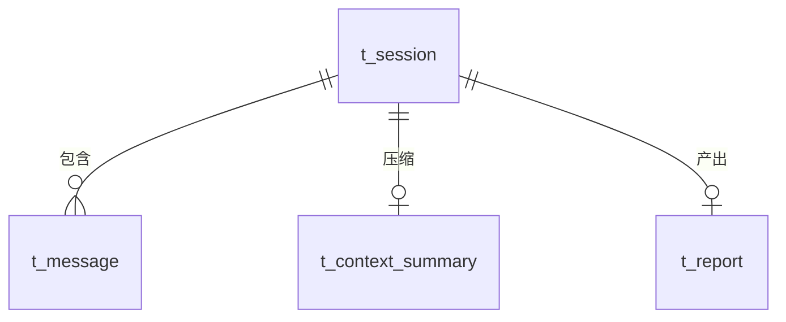
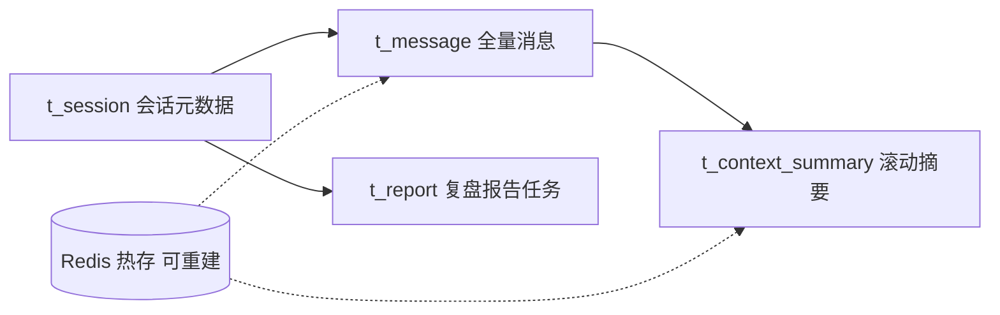

# AI 模拟面试平台 数据库表设计 汇总方案

作者:Sakura | 创建时间:2026-10-31

定位：本文是**已落地四表的汇总设计文档**，把散在步骤 5、步骤 6 指令与 schema.sql
里的设计归一，补齐设计理由、索引对照与容量口径。表结构以
`backend/src/main/resources/sql/` 为可执行事实，本文不改动任何表。

## 一 设计演进记录

| 时间 | 出处 | 内容 |
|---|---|---|
| 10-29 | 技术方案存储节 | 三表草图：t_session、t_message、t_report |
| 10-31 步骤 5 | 开发指令 + session-schema.sql | t_session、t_message 细化为 DDL，新增 t_context_summary |
| 10-31 步骤 6 | 开发指令 + report-schema.sql | t_report 任务表化，增加状态机与重试次数字段 |
| 11-01 | 用户认证-账号密码改造方案 | 规划：新增 t_user 表，t_session 增 user_id 列与索引，Redis 增 auth:session 键（后端待实施，落地时更新本文） |

草图到落地的三处演进：t_session 存简历摘要与 JD 要点而非原文；t_message 主键从
自增 id 改为会话内序号联合主键并新增 token 两列；t_report 从纯结果表改为
状态机任务表。演进理由见第三节问答。

## 二 表关系总览

写入顺序约束：先 MySQL 后 Redis；会话元数据每轮按主键直查 MySQL 不进缓存。

## 三 四表字段级设计

### t_session 面试会话

| 字段 | 类型 | 说明 |
|---|---|---|
| session_id | VARCHAR(36) PK | 业务主键，s- 前缀 8 位随机 |
| resume_digest | TEXT | 简历结构化摘要（建会话时一次生成，不存原文） |
| jd_direction | VARCHAR(255) | 岗位方向（拆列供展示与统计） |
| jd_skills / jd_bonus | TEXT | 技能与加分项 JSON 数组 |
| asked_questions_json | TEXT | 已问题目摘要清单（单条 60 字，保留最近 40 条） |
| round_no | INT | 面试轮次（闲聊轮不计入） |
| status | VARCHAR(20) | ACTIVE、ENDED（列名用 round_no 避开保留字歧义） |
| created_at / ended_at | TIMESTAMP | 报告时长统计用 ended_at 与消息时间互补 |

### t_message 消息记录

| 字段 | 类型 | 说明 |
|---|---|---|
| session_id + seq | 联合主键 | seq 为会话内单调序号，单写者以 MAX 加 1 分配 |
| role | VARCHAR(16) | user、interviewer、chat 三值 |
| content | TEXT | 消息全文，评估阶段全量读 |
| input_tokens / output_tokens | BIGINT | 模型实测用量，用户消息记 0；简历要点 3 的数据源 |

### t_context_summary 上下文摘要

| 字段 | 类型 | 说明 |
|---|---|---|
| session_id | PK | 一场会话一份当前摘要 |
| summary_text | TEXT | 滚动合并后的前情摘要（上限 2500 字符，代码层截断） |
| covered_seq | INT | 摘要已覆盖的最大消息序号，单调递增，重启不重复摘要 |

### t_report 复盘报告任务

| 字段 | 类型 | 说明 |
|---|---|---|
| task_id | VARCHAR(36) PK | r- 前缀 8 位随机 |
| session_id | UNIQUE | 一场会话一份报告，submit 据此幂等 |
| status | VARCHAR(20) | GENERATING、RUNNING、DONE、FAILED 状态机 |
| retry_count | INT | 失败次数，达 3 置 FAILED，重新提交时清零 |
| report_json | LONGTEXT | InterviewReport 整体序列化（四维评分、逐题、建议、统计） |
| error_msg | VARCHAR(500) | 最近一次失败原因，降级不伪装的审计记录 |

### Redis 热存（可丢失可重建）

| Key | 结构 | 说明 |
|---|---|---|
| session:msgs 会话id | List | 消息 JSON 追加，读最近窗口，TTL 24 小时每轮续期 |
| session:summary 会话id | String | 摘要与覆盖边界 JSON，TTL 同上 |

## 四 索引与查询路径对照

| 查询 | 走的索引 |
|---|---|
| loadSession / saveSession upsert / endSession | t_session 主键 |
| readWindow 最近 N 条 | t_message 联合主键（会话前缀加 seq 倒序） |
| readBatch 压缩器取批 / readAll 评估全量 | t_message 联合主键 |
| appendMessage 的 MAX 加 1 分配 | t_message 联合主键最左前缀 |
| submit / loadBySession 幂等 | t_report session_id 唯一键 |
| Worker claim 扫描 GENERATING | 全表扫，任务表行数等于会话数，量级极小，不加冗余索引 |

## 五 容量估算与数据生命周期

- 单场 60 轮约 120 条消息，按平均 1.5KB 约 180KB；百场约 18MB，开发期与初版无压力
- Redis 两类 key TTL 24 小时自然过期；MySQL 为审计与报告原料永久保留
- deleteSession 端口已备（自检清理用）；步骤 8 可加定时归档历史会话
- 进程重启恢复链：Redis 未命中从 MySQL 重建窗口与摘要，残留 RUNNING 报告任务
  启动时重置回 GENERATING，全部经真机验证

## 六 设计问答（面试口径）

1. **为什么消息表用联合主键而不是自增 id？** seq 是会话内单调序号，同时充当
   上下文窗口、摘要边界 covered_seq、报告配对三个功能的位置锚点；按会话取最近
   N 条直接走主键，自增 id 还需要额外排序语义。
2. **为什么 token 落库？** 简历要点 3 的 Token 开销下降数据必须来自逐轮实测，
   t_message 是唯一能同时画出单轮曲线与整场合计的地方。
3. **报告为什么整体存 JSON 不拆表？** 报告整体读整体写，无字段级查询需求；
   拆表徒增关联。竞品的题目清单与参考答案也是 JSON 整存，同类取舍。
4. **为什么 MySQL 事实源加 Redis 缓存，而不是只留一份？** Redis 承担热读与
   TTL 生命周期，丢了可从库重建；崩溃恢复与审计靠 MySQL。写序先库后缓存。
5. **MAX 加 1 分配 seq 有并发风险吗？** 当前单进程单写者无并发；多实例化时
   属步骤 8 课题，届时改 Redis 计数器即可，端口已隔离存储实现。
6. **为什么不用 JPA？** 查询简单且量小，JdbcTemplate 加显式 SQL 直观可调优；
   SessionStore 端口已把存储选型隔离在 infra 层。

## 七 后续演进

- 步骤 9 评测若引入评测集与命中记录，按增量 DDL 新增 eval 类表，届时更新本文
- 认证改造（2026-11-01 方案已确认未落地）：新增 t_user、t_session 增 user_id 列、Redis 增 `auth:session:{token}` 会话键；开发期无真实数据，存量 t_session 直接清库不做通用迁移（用户已确认）
- 多实例部署（步骤 8 课题）时的 seq 分配与 Worker 抢占并发化，见第五节问答 5
