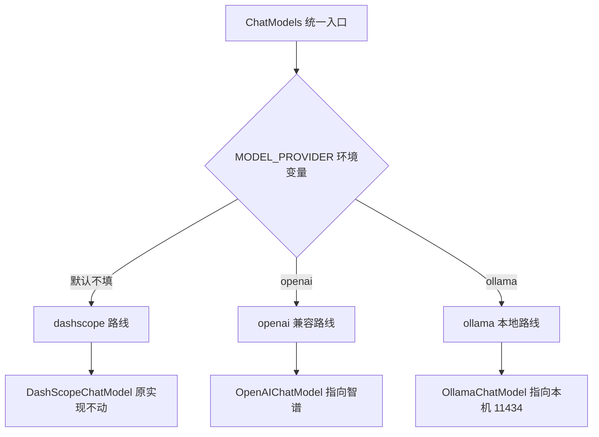

# AI 模拟面试平台 模型Provider接入 优化方案

作者:Sakura | 创建时间:2026-10-31 13:47

## 1 背景与目标

步骤 1 的模型客户端硬绑定 DashScope：密钥没注册下来，命令行 3 轮对话验证一直卡住。2026-10-31 用户拍板模型路线：

- **开发期主力：智谱 GLM**（bigmodel.cn 开放平台，OpenAI 兼容接口，注册即用）
- **正式评测与简历口径：百炼 DashScope qwen-plus**（步骤 9 评测数据必须用正式目标跑，口径才一致）
- **本地冒烟：Ollama qwen2.5:7b**（本机已装已拉模型，零密钥零成本，永远可用）

目标：模型源从"写死的 DashScope"变成"环境变量切换的三路 provider"，任何一路拿不到 key 都不阻塞开发。

前置核验已完成（2026-10-31，javap 本地仓库 jar）：

- `agentscope-extensions-model-openai:2.0.3`：Builder 含 apiKey、baseUrl、modelName、endpointPath、nativeStructuredOutput
- `agentscope-extensions-model-ollama:2.0.3`：Builder 含 modelName、baseUrl、stream，无需 apiKey
- 两个扩展与项目现有 dashscope 扩展同版本，pom 直接引

## 2 Provider 切换设计

三路 provider 的环境变量与用途：

| provider 值 | 环境变量 | 指向 | 用途 |
|---|---|---|---|
| 不填 默认 dashscope | DASHSCOPE_API_KEY、DASHSCOPE_MODEL | 百炼 | 正式评测与简历口径 |
| openai | OPENAI_API_KEY、OPENAI_BASE_URL、OPENAI_MODEL | 智谱 bigmodel.cn | 开发期主力 |
| ollama | OLLAMA_BASE_URL、OLLAMA_MODEL | 本机 11434 | 零成本冒烟 |

设计要点：

- 默认值保持 dashscope：仓库克隆下来行为与文档正式口径一致，开发期在 `.env` 里显式写 `MODEL_PROVIDER=openai`
- openai 路线通吃一切 OpenAI 兼容端点：智谱、DeepSeek、硅基流动，换源只改 env 三行，代码不再动
- 智谱参数：OPENAI_BASE_URL 填 `https://open.bigmodel.cn/api/paas/v4`，OPENAI_MODEL 按控制台型号列表选

## 3 改动清单

- [ ] `backend/pom.xml`：加 `agentscope-extensions-model-openai`、`agentscope-extensions-model-ollama` 两个依赖，版本走现有 `agentscope.version` 属性
- [ ] `infra/DashScopeModels.java`：重命名为 `ChatModels.java`，入口方法按 MODEL_PROVIDER 三分支分派；dashscope 分支保持原逻辑原样
- [ ] `infra/EnvKeys.java`：新增 MODEL_PROVIDER 与 openai、ollama 两组键的读取方法
- [ ] `agent/InterviewerAgent.java` 与 `InterviewerCliRunner.java`：调用点从 `DashScopeModels.qwen()` 改为 `ChatModels.chat()`，各一行
- [ ] `backend/.env.example`：补 MODEL_PROVIDER、OPENAI_API_KEY、OPENAI_BASE_URL、OPENAI_MODEL、OLLAMA_BASE_URL、OLLAMA_MODEL 六键，并顺手补上遗漏的 DASHSCOPE_MODEL，全部带注释
- [ ] 顺带项：`application.yml` 数据源默认端口 3307 改 3306、Redis 默认 6380 改 6379（2026-10-31 本地优先决策的落地，此前已单独列出待确认）

## 4 验证方式

1. Ollama 路（零密钥，改完立即跑）：`.env` 写 `MODEL_PROVIDER=ollama`，`mvn compile exec:java` 完成 3 轮对话
2. 智谱路（用户注册拿到 key 后）：`.env` 写 `MODEL_PROVIDER=openai` 加三键，同命令 3 轮对话
3. DashScope 路（百炼 key 到位后）：MODEL_PROVIDER 不填，原验证流程
4. 安全检查不变：`git grep "sk-"` 无结果，`git ls-files` 看不到 `.env`，日志无密钥明文
5. 验证通过后 commit：`step1: 模型provider三路接入与环境本地化`（与既有步骤 1 代码一并提交）

## 5 角色分模型映射 前瞻 步骤 4 用

正式口径的角色分模型表（后端架构方案 3.3 节）不变。开发期切智谱时按档位对应：qwen-turbo 档的轻量任务（路由、改写、摘要）用免费的 glm-4-flash；qwen-plus 档的核心任务（面试官、评分）用智谱更强付费档，具体型号以控制台列表与赠送额度为准。此映射只影响开发期体验，不影响评测与简历数据口径。

## 6 明确不做

- 不换 AgentScope 引擎，不引 Spring AI
- 不做多 Provider 管理页与多密钥池（竞品明确不抄项）
- 不动 REST 与 SSE 接口契约
- 不在本批次实现角色分模型（那是步骤 4 的编排内容）

## 7 待确认事项（需用户确认）

1. 执行主体：本方案由当前 AI 直接实现，或交开发会话按此文档执行
2. 顺带项 application.yml 端口翻转是否与本批次一起做
3. 智谱主力档位选择：链路验证用免费 glm-4-flash，跑面试官体验时再上付费强档（建议默认此策略）
