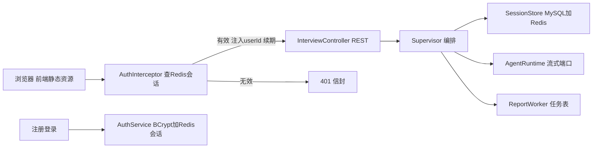
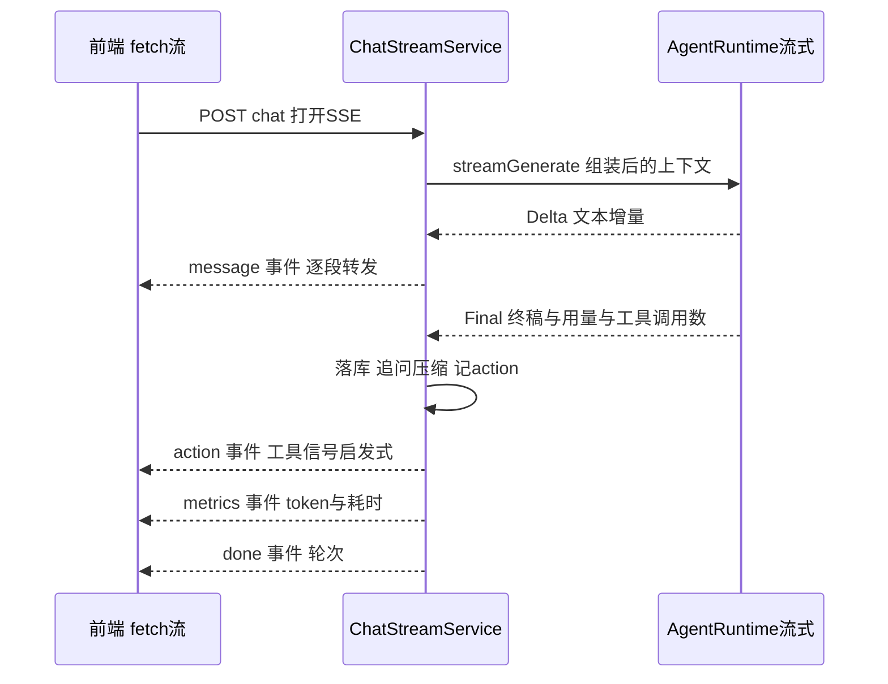

# AI 模拟面试平台 开发指令 步骤 7

作者:Sakura | 创建时间:2026-11-01（方案架构师产出，交开发 AI 执行）

## 你的角色与边界

你是本项目的开发执行 AI。按本指令实现步骤 7：REST 与 SSE 全量接口、账号认证、按用户隔离、前端联调。不做方案外发挥；遇到指令未覆盖的技术决策，停下来问用户。

## 必读文档（按顺序）

1. `.agentdocs/plans/2026-10-29/AI模拟面试平台-接口文档.md`（10-31 修订版：信封、SSE 五事件、fetch 流式、断线轮询恢复）
2. `.agentdocs/plans/2026-11-01/用户认证-账号密码改造方案.md`（本步并入其 A1 与 A2；第 5 节五项已获用户确认）
3. `frontend/src/api/*.ts` 与 `frontend/src/types.ts`（前端已实现的调用契约，以代码为准）
4. 本文档全文

## 背景：后端缺口清单

前端全部就绪（F0-F7 加认证 A3，生产构建直落 backend static）。后端缺口：

1. 无任何 REST 接口（现为纯命令行）；Supervisor 全家不是 Spring bean
2. 无账号体系（A1 待做）；无按用户隔离（A2 待做）
3. t_session 缺 user_id、difficulty、question_count；状态机是 ACTIVE、ENDED，需换为 CREATED、IN_PROGRESS、ENDED、REPORTED
4. t_message 缺 action（前端徽章依赖）与对前端的消息时间字段；消息角色需映射为大写 INTERVIEWER、CANDIDATE
5. 无 SSE 流式：现有 AgentRuntime 只返回整段回复

已核验的技术事实（javap 过，勿再猜）：

- AgentScope ReActAgent 有 `streamEvents(String)` 等重载，返回 `Flux<AgentEvent>`
- 事件枚举含 TEXT_BLOCK_DELTA（增量文本，getDelta()）、THINKING_BLOCK_*（思考，忽略）、
  TOOL_CALL_START（工具调用信号）、AGENT_RESULT（终稿，getResult() 返回 Msg 可取 usage）
- F7 已把前端构建产物输出到 `backend/src/main/resources/static`，SPA 兜底由后端补

## 总体设计



SSE 单轮时序（接口文档 4.3 的落地）：



## 数据层增量

新增 `resources/sql/auth-schema.sql` 与列迁移。MySQL 不支持 ADD COLUMN IF NOT EXISTS，
在 `MySqlDb` 加迁移助手：查 information_schema 判断列存在再 ALTER，幂等。

```sql
CREATE TABLE IF NOT EXISTS t_user (
  id            BIGINT AUTO_INCREMENT PRIMARY KEY,
  username      VARCHAR(64) NOT NULL,
  password_hash VARCHAR(100) NOT NULL,
  created_at    TIMESTAMP DEFAULT CURRENT_TIMESTAMP,
  CONSTRAINT uk_user_username UNIQUE (username)
) ENGINE = InnoDB DEFAULT CHARSET = utf8mb4;
```

t_session 增列：`user_id BIGINT NULL`、`difficulty VARCHAR(16) NOT NULL DEFAULT 'MEDIUM'`、
`question_count INT NOT NULL DEFAULT 10`，加索引 `idx_session_user(user_id)`。
t_message 增列：`action VARCHAR(16) NULL`。
存量清库已获用户确认：`SessionCliRunner` 增 `reset-data` 子命令一次性清空四张业务表。

## 分步任务

### 7a 数据层与领域扩展

1. DDL 与迁移助手按上文；init-db 依次执行三个 schema 与列迁移
2. `StoredMessage` 增 `createdAt`（String，ISO 时间，兼容旧 JSON 为 null；保留五参构造重载）
3. `SessionState` 增 config（SessionConfig）、status（默认 CREATED）、userId（可空，CLI 会话为 null）；
   saveSession 落 config 与 user_id；**upsert 不再改写 status**（INSERT 写 CREATED），
   loadSession 读出 status 与 config
4. SessionStore 端口扩展：`updateStatus(sessionId, status)`、`appendMessage` 增 action 参数
   （保留旧签名重载委托）、`overview(sessionId)` 与 `listOverviews(userId, page, size)` 返回
   新 record `SessionOverview(sessionId, status, direction, difficulty, questionCount, createTime)`
5. FakeSessionStore 同步；既有测试迁移

### 7b 认证 A1

1. pom 增 `org.springframework.security:spring-security-crypto`（仅取 BCrypt，不引入 security 全家）
2. `infra/RedisAuthStore`：Lettuce 独立客户端。会话键 `auth:session:{token}` 值 userId，
   TTL 24 小时；解析时滑动续期；登录失败计数 `auth:fail:{username}`（5 次锁 1 分钟）
3. `api/AuthService`：注册（用户名 3-32 位、密码至少 8 位、BCrypt 落库、注册即登录）、
   登录（校验、失败计数、成功清零）、登出（删会话）。令牌 32 字节随机 hex
4. `api/AuthController`：POST /api/auth/register、login、logout，出参
   `data: {token, username}`；错误走统一信封（用户名占用、凭据错误、锁定中）
5. `api/AuthInterceptor`：拦 `/api/**` 放行 `/api/auth/**`；查 Redis 会话，注入
   `userId` 请求属性并续期；无效返回 401 信封。APP_TOKEN 退役：`.env.example`
   删 APP_TOKEN 行，README 快速开始改为注册即用

### 7c 面试 REST A2

1. `api/ApiEnvelope` 统一响应与 `ApiException`（401、404 会话不存在、409 状态冲突、413 超限、500）
2. `api/InterviewController`：
   - POST /api/interviews：JSON（resumeText、jdText、config）与 multipart（resumeFile 走
     ResumeParseTool 提取，上限 5MB；jdText 表单域；config 为 JSON 字符串域）。创建会话写
     userId、config，状态 CREATED。校验：jdText 20KB、content 8KB、resumeFile 5MB
   - POST /{id}/start：CREATED 才可用否则 409；置 IN_PROGRESS；返回
     `firstQuestion`（固定开场白：请做自我介绍并讲与岗位相关的技能与项目经历，不调模型）与
     `focusPoints`（JD skills 前五项）
   - POST /{id}/end：IN_PROGRESS 才可用否则 409；幂等：已有报告任务直接返回其状态，
     无任务才结束会话并提交；返回 `data: {reportStatus}`
   - GET /{id}/report：任务 DONE 返回 202 信封 `data: {reportStatus: GENERATING}`（HTTP 仍 200，
     信封 code 202，前端按此判别）；完成返回 InterviewReport；同时把会话置 REPORTED
   - GET /api/interviews?page、size：按 userId 分页倒序，`data: {total, list}`
   - GET /{id}：`data: {session: SessionOverview, messages}`；消息映射 role 小写转
     INTERVIEWER、CANDIDATE，带 action、tokens、time
   - 全部接口按 userId 过滤：查不到本用户的会话一律 404（不区分不存在与无权限）
3. ReportWorker 完成任务时把会话置 REPORTED（注入 SessionStore）

### 7d SSE 流式 4.3

1. 端口扩展：`agent/StreamChunk`（sealed：`Delta(text)`、`Final(fullText, inputTokens,
   outputTokens, toolCalls)`）；`AgentRuntime` 增 `Flux<StreamChunk> streamGenerate(四参)`，
   原 generate 保留为默认方法（取最后一个 Final）
2. `AgentScopeRuntime` 实现流式：streamEvents 映射——TEXT_BLOCK_DELTA 出 Delta；
   TOOL_CALL_START 计数；AGENT_RESULT 出 Final（fullText 取全流 Delta 拼接，保证与已推送
   内容一致，无 Delta 时回退终稿文本；用量取终稿 Msg usage）；THINKING 与工具事件不出
3. `Supervisor` 增监听版 `chat(sessionId, text, TurnListener)`（listener 收 Delta 转发）；
   面试官回复落库前按工具信号推导 action 并随消息写入：无工具调用 FOLLOW_UP，有工具调用且
   首题 QUESTION 否则 NEXT；SupervisorReply 增 action 字段；旧两参 chat 委托
4. `api/ChatStreamService`：SseEmitter 超时 320 秒；有界线程池（core4 max8）执行；
   状态非 IN_PROGRESS 发 error 事件；REPORT 意图把 ReportService 回复作为单个 message 事件
   发出后 done；异常发 error 终流不发 done；**客户端断线不取消生成**，照常落库
   （前端 3 秒轮询会话详情恢复，不做 SSE 续传）

### 7e Spring 装配与静态托管

1. `api/AppConfig`：DataSource（@Bean 令自动配置退避，actuator 健康检查复用同一池）、
   RedisSessionCache、PersistentSessionStore、MySqlReportStore、MilvusQuestionStore
   （destroyMethod 关闭）、AgentScopeRuntime、Supervisor（含 ReportService 与压缩器）、
   ReportWorker（随上下文启停）、chat 流线程池
2. SPA 兜底：非 api、actuation 前缀的 GET 一律 forward `index.html`；静态资源走 classpath:/static/
3. application.yml 补 multipart 上限 5MB

### 7f 验证

1. 单测：AuthService（BCrypt、重复注册、锁定）、拦截器 401、控制器 MockMvc（信封、409、404、
   userId 过滤）、SSE 流（fake AgentRuntime 出 Delta 序列，断言事件顺序 message*、action、
   metrics、done 与落库 action）；全量回归
2. curl 链路：注册、登出后再访问 401、建会话、start、chat 流式、end、report 轮询 202 到完成
3. 真机 UI 联调：后端 8080 起 Spring 应用，前端 vite dev（5174）代理到 8080，浏览器全流程
   走通：注册登录、建会话、流式答题（肉眼确认逐字输出）、追问徽章、结束面试、报告轮询出分、
   刷新后恢复会话、双账号互相看不到对方会话
4. 验证通过单独 commit：`step7: REST与SSE接口及账号认证`，实现文档写
   `.agentdocs/code-changes/2026-11-01/AI模拟面试平台-步骤07-实现.md`

### 7g 文档同步（A4，架构师职责随本步执行）

需求 4.2、7.1 与技术方案 4.2、5 及接口文档第 1、4 节按认证方案修订：auth 三接口、
拦截器变更、4.7 消息回带 action 与大写角色、APP_TOKEN 退役；README 快速开始改注册即用。

## 全程约束

- 单文件不超 300 行；端口红线不破（api 与 agent 不 import AgentScope）
- 密钥与密码：BCrypt 落库无明文；日志不落密码与简历全文；提交前 `git grep "sk-"` 干净
- SSE 用 fetch 流前端已定型，后端不改协议；CORS 不开（vite 代理与同域反代方案不变）
- 共享工作区若在 frontend 分支，沿用 worktree cherry-pick 流程落 main

## 不做清单

4.9 报告重试与 4.10 删除会话（P1 待确认）、图片输入（P1）、JWT、邮箱验证、角色权限、
EventSource 兼容、SSE 续传、token 级思考流展示、注册开关

## 需用户确认

1. start 的 firstQuestion 用固定开场白不调模型，focusPoints 取 JD 技能前五（推荐，省时省 token）（需用户确认）
2. action 分类用工具调用信号启发式：无工具调用 FOLLOW_UP、有工具且首题 QUESTION 否则 NEXT，零额外成本（推荐；LLM 精分类留作后续增强）（需用户确认）
3. SSE 文本口径：推送的 Delta 拼接即落库文本，保证刷新前后一致（推荐）（需用户确认）
