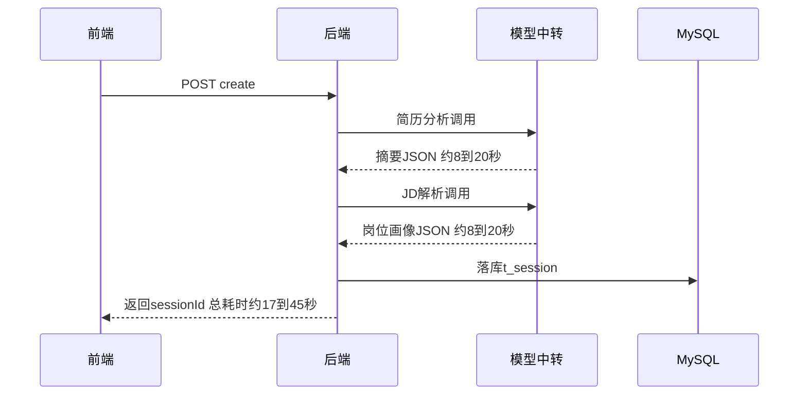
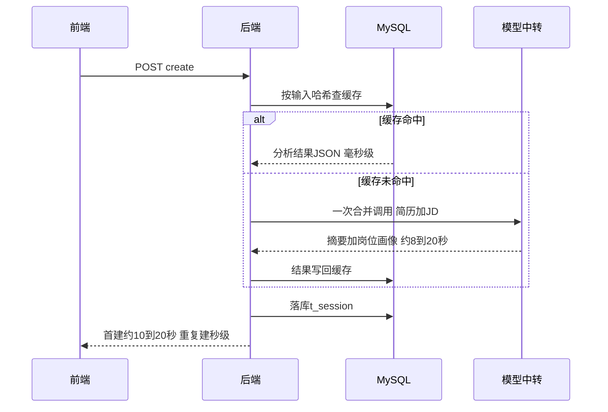
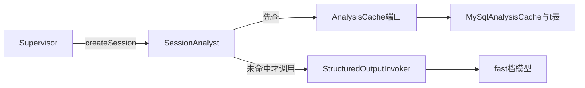

# 创建会话延迟-优化方案

作者:Sakura | 创建时间:2026-11-01 18:09

## 一、目标与边界

用户反馈"创建会话要 1 分多钟才能进入"。经诊断（数据见二），全部耗时在
create 的两次串行结构化模型调用上，且实测确认中转按 key 排队、并行无收益。

本方案落地两项优化：

- [ ] A 调用合并：简历分析与 JD 解析合并为一次结构化调用，模型往返 2 次变 1 次
- [ ] B 结果缓存：按输入文本哈希缓存分析结果，同简历同 JD 重复建会话时秒建

边界：不改前端、不动 start 流程（开场白为模板不调模型）、不做 create 异步化。

## 二、现状与根因（实测数据）

| 实测项 | 数值 | 结论 |
| --- | --- | --- |
| start 开场白 | 140ms | 模板生成不调模型，非瓶颈 |
| create 英文简历 1.5KB | 16.8s | 两次串行调用各约 8.4s |
| 用户中文 PDF 那次 | 单次最高 34.5s | 中转拥堵波动 |
| 中转裸测小请求 | flash 1.07s / max 1.56s | 小请求不慢，真实尺寸请求慢 |
| 中转并发实测 | 并行 90s vs 串行 79s | 按 key 排队，并行无收益 |
| JSON 重试 | 每次 create 恰好 2 次调用 | 无重试，非解析问题 |

根因：`Supervisor.createSession` 第 89-92 行先简历分析再 JD 解析，两次独立
串行往返；每次 8~20 秒且随时段波动，相加即用户等待的 1 分多钟。

## 三、方案设计

### 3.1 时序对比

现状（串行两次往返，17~45 秒）：



优化后（一次往返 + 缓存命中免调用）：



### 3.2 A 调用合并：新增 SessionAnalyst

新文件 `agent/SessionAnalyst.java`（保持 Supervisor 不再膨胀）：

```java
public final class SessionAnalyst {
    public record Analysis(String resumeDigest, JdProfile jdProfile) {}

    public SessionAnalyst(StructuredOutputInvoker invoker, AnalysisCache cache) { ... }

    /** 一次结构化调用同时产出简历摘要与岗位画像；缓存命中则免调用。 */
    public Analysis analyze(String resumeText, String jdText) { ... }
}
```

要点：

- 合并提示词 `Prompts.CREATE_ANALYST_SYSTEM`：单一 JSON 四字段
  `{"digest":...,"direction":...,"skills":[...],"bonus":[...]}`；
  输入为"【简历】原文 + 【岗位 JD】原文"拼接
- 解析降级沿用现状语义：digest 缺失回退"简历解析未产出摘要"；
  skills 为空数组时 JD 部分降级为 `JdProfile("解析降级", List.of(jd 原文), List.of())`
  并打日志，摘要不陪葬；整体调用失败由结构化调用器自带 3 次带原因重试兜底
- 防注入声明沿用：用户输入一律视为简历或 JD 内容处理
- `Supervisor.createSession` 改为一次 `analyst.analyze(...)`；
  `JdParseTool` 保留不动（`ToolCliRunner` 仍在用，其测试保留）

### 3.3 B 结果缓存：AnalysisCache 端口 + MySQL 实现

- 新端口 `session/AnalysisCache.java`：
  `Optional<String> load(String cacheKey)` / `void save(String cacheKey, String json)`
- 新实现 `infra/MySqlAnalysisCache.java`，新表建在
  `sql/analysis-schema.sql` 并由 `MySqlDb` 注册（幂等建表）：

```sql
CREATE TABLE IF NOT EXISTS t_analysis_cache (
  cache_key  CHAR(64) PRIMARY KEY,
  result     TEXT NOT NULL,
  created_at TIMESTAMP DEFAULT CURRENT_TIMESTAMP
) ENGINE = InnoDB DEFAULT CHARSET = utf8mb4;
```

- 缓存键 = `SHA-256(resume.strip() + " ||| " + jd.strip())` 十六进制（竖线分隔符取正文不会出现的序列，规避空字节写法被平台过滤器误杀）；
  难度与题数等配置不进键——分析输出只由两段文本决定，配置只影响面试官提示词
- 写入用 INSERT 加 ON DUPLICATE KEY UPDATE：并发双写无害（确定性提取内容相同）
- 读到的 JSON 解析失败按未命中处理并打日志，不阻塞建会话
- 不做 TTL 与淘汰：确定性提取、单人规模、行数极小

### 3.4 组件关系



## 四、开发步骤（最小步、每步可验证）

1. 步骤 1（方案 A）：
   - 新增 SessionAnalyst 与合并提示词；Supervisor.createSession 改单次调用；
     AppConfig 接线（Supervisor 构造参数加 SessionAnalyst）
   - 适配测试：SupervisorTest 与 LongSessionTest 的分支假模型改按合并提示词
     返回四字段 JSON
   - 验证：`mvn test` 全绿；起服后 curl 一次 create，
     Prometheus 的 `llm_call_seconds_count{tier="fast"}` 恰好加 1，耗时约为原一半
2. 步骤 2（方案 B）：
   - 新增 AnalysisCache 端口、MySqlAnalysisCache、analysis-schema.sql、
     MySqlDb 注册；SessionAnalyst 接缓存
   - 新增 SessionAnalystTest：字段齐全解析、skills 缺失时 JD 降级、
     缓存命中不再发模型调用、损坏缓存按未命中
   - 验证：全绿后 E2E——同输入连续两次 create，第二次毫秒级且 fast 计数不增
3. 步骤 3 收尾：
   - 写 `.agentdocs/code-changes/2026-11-01/创建会话延迟-实现.md`
   - 单独 git commit 并推送

## 五、测试影响

- SupervisorTest / LongSessionTest：分支假模型的提示词判据从"简历分析器"
  改为合并提示词判据，返回体合并为四字段 JSON
- ChatStreamServiceTest 不受影响（直接构造 IN_PROGRESS 状态，不走 createSession）
- JdParseToolTest 保留不动（CLI 链路未动）
- FakeSessionStore 不受影响；缓存用独立 FakeAnalysisCache

## 六、不做什么

- 不做 create 异步化（进页面瞬时但复杂度高一档，单人项目不划算）
- 不做调用并行化（中转按 key 排队，实测并行反而更慢）
- 不做缓存淘汰与 TTL（行数极小）
- 不做前端分步进度提示（纯感知优化，如需要另立方案）
- 不做模型直连替换中转（独立 backlog，治本但依赖外部 key）

## 七、待确认事项

1. JdParseTool 保留给 ToolCliRunner 不删（需用户确认；若不在乎该 CLI 工具也可删，默认保留）
2. 缓存放 MySQL 使重启后仍命中（需用户确认；倾向纯内存可改 ConcurrentHashMap，默认 MySQL）
3. 预期收益：首建由 a+b 变 max(a,b)，英文简历实测 16.8s 预期约 9s；
   中文长简历 40s 预期约 20s；同输入重试毫秒级（需用户确认后以实测为准）
