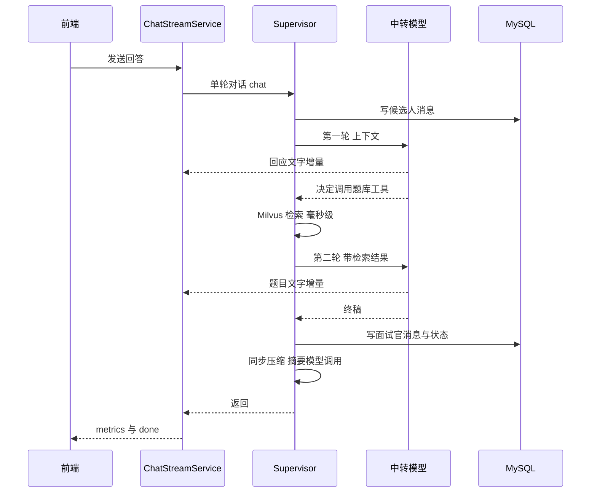
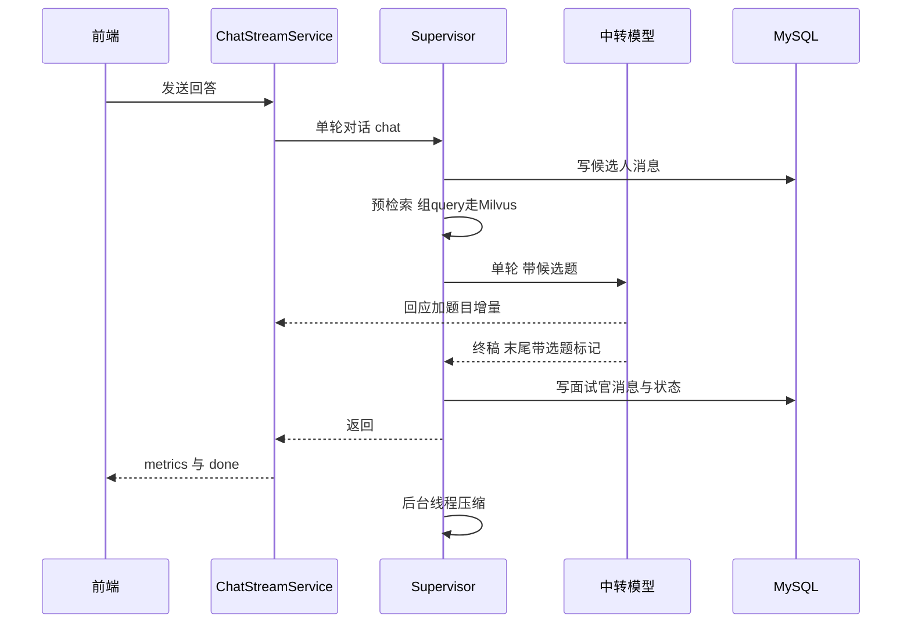
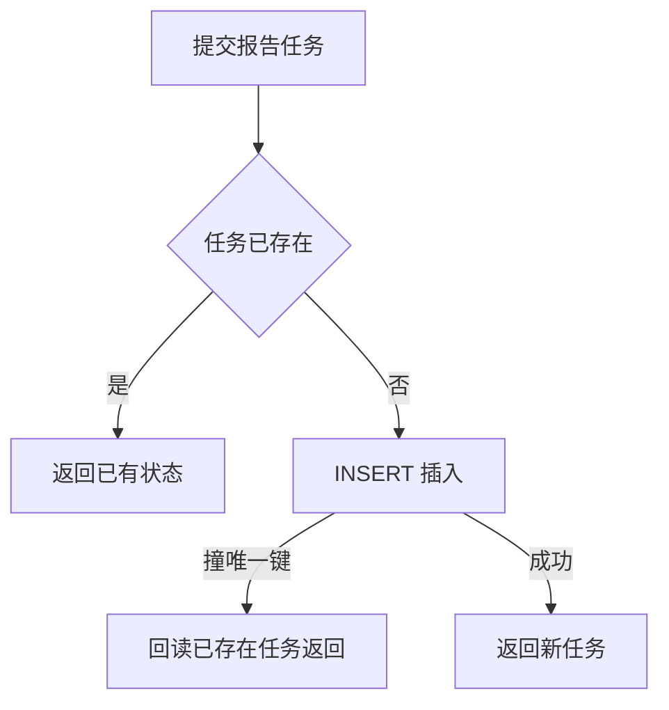
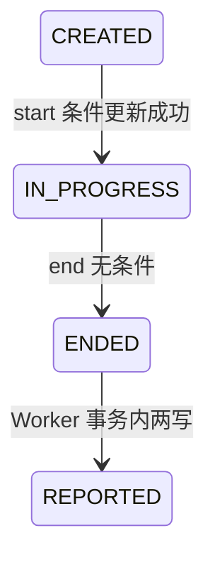

作者:Sakura | 创建时间:2026-11-01 13:41

# 性能与健壮性-优化方案

## 1 背景与目标

真实使用暴露两类问题，本方案一批解决：

**性能**：出题轮单轮 20 到 36 秒（s-e83d85db 实测 25 27 18 29 36 秒，闲聊轮仅 6 秒）。根因一：出题要两次串行模型往返，第一次只为决定调题库工具。根因二：上下文压缩的摘要调用同步堵在轮次里，第 30 条与第 40 条消息各触发一次，估计每次额外 20 到 60 秒，且文字流完后 done 事件迟迟不发。

**健壮性**：幂等与状态推进全部是先查后写，无事务无条件更新。t_report 唯一键与 t_message 主键兜底保证库不坏，但并发双击会 500，Worker 两写之间崩溃会让会话永远停在 ENDED。

**验收目标**：出题轮总时长降到 10 到 20 秒；压缩不阻塞 done 事件；双击与崩溃场景无 500、无状态漂移；既有 95 个单测全绿。

## 2 现状根因

### 2.1 出题轮的三段耗时构成

- 第一往返约 8 到 13 秒：模型读 1 至 3k token 上下文后输出工具调用
- Milvus 检索毫秒级，不是瓶颈
- 第二往返约 10 到 20 秒：模型生成 150 到 500 token 的回应与题目
- 压缩触发轮：done 事件等待摘要调用结束，用户面对已流完的文字干等

### 2.2 幂等与状态机的缺口

| 位置 | 触发 | 后果 | 现状 |
|---|---|---|---|
| MySqlReportStore 的 submit 先查后插 | 双击结束 | 撞唯一键裸抛 500 | 重试可自愈 |
| ReportWorker 两写 | complete 与 REPORTED 之间崩溃 | 会话永远停在 ENDED | 无自愈路径 |
| start 读后判 | 双击开始 | 双开场白或撞主键 500 | 部分自愈 |
| chat 交给线程池后 | 结束与生成并发 | 已结束会话仍追加消息 | 可容忍 |
| 同会话并发 chat | 断线重试加手快 | MAX 加 1 撞主键 500 | 可容忍 |

endSession 与 submit 之间崩溃可以自愈（守卫是任务不存在），不处理。

## 3 方案设计

### 3.1 预检索出题：砍掉第一次模型往返

思路：出题检索从模型思考中途挪到调模型之前。每轮面试官回复前先检索题库，把候选题文本块注入系统提示词，模型一次生成完成回应与出题。

**检索 query 构造**：JD 方向拼候选人本轮回答前 120 字。不走 QueryRewriter（它本来也不在运行链路，只在 CLI 工具用）。检索复用 `QuestionBankTool.retrieveAsText`，其无命中时自带提示模型自行出题的文案，作为质量出口。

**选题标记约定**（替代工具调用信号做题型判定，用户已确认不带题库序号）：

- 系统提示词新增规则：出新题时必须以单独一行的 `选题` 结尾；候选题不合适可自行出题，同样以 `选题` 行结尾；追问时不写选题行
- 后端解析：终稿最后一个非空行以 `选题` 开头即判新题，按 round 为 0 判 QUESTION 否则 NEXT，无标记判 FOLLOW_UP（与现有前端消费逻辑完全兼容，QUESTION 与 NEXT 都推进题号）
- 后端剥离：标记行从落库文本与已问题单中剥除，再走 appendMessage 与 recordAsked
- 前端剥离：useInterviewStream 累积流式文本时正则剥除行尾标记行，避免闪现

**改动点**：

1. `Supervisor` 构造器注入 `QuestionBankTool`（其依赖 QuestionSearcher 端口，测试注入 fake searcher）
2. `Prompts.interviewerSystem` 增加 candidates 参数，行为规则第 1 条从调用工具改为从候选题选用，新增选题标记规则
3. `Supervisor.deriveAction` 改为解析选题标记，新增静态方法解析与剥离标记行
4. `AgentScopeRuntime`：AppConfig 传空工具列表，面试官 maxIters 由 3 改 1，删除 `QuestionBankAgentTool` 挂载；`QuestionBankAgentTool` 类删除
5. 前端 useInterviewStream 剥除行尾选题标记
6. 全仓搜索 `new Supervisor(` 与 `new AgentScopeRuntime(` 同步改造（AppConfig 与 InterviewerCliRunner 与 OrchestrationCliRunner 与各测试）

### 3.2 压缩异步化：done 不等压缩

- `Supervisor` 构造器新增 Executor 参数，agentTurn 落库后经它执行 compressIfNeeded，任务内包 try catch 记日志；既有构造器默认直接执行，CLI 与既有单测行为不变
- AppConfig 新增单守护线程 executor（命名 ctx-compress），注入 Supervisor；单线程天然串行，避免同会话摘要互相覆盖
- 压缩失败降级语义不变：沿用旧摘要退化为仅窗口；崩溃丢失的批次由 coveredSeq 记账，下轮补

### 3.3 入库加固五处

1. **submit 吸收撞键**：INSERT 捕获 DataIntegrityViolationException 后回读已存在任务返回，双击结束的第二个请求拿到已有状态而非 500
2. **Worker 两写事务**：ReportWorker 构造器新增可选 TransactionOperations，process 里 complete 与 updateStatus REPORTED 同事务执行；为空则直接执行，CLI 与单测不变。注意事务方法必须在 Spring bean 上，不能放 controller
3. **start 条件更新**：SessionStore 端口新增 `casStatus(sessionId, from, to)` 返回是否成功，SQL 为 `UPDATE t_session SET status = ? WHERE session_id = ? AND status = ?` 判影响行数；controller start 用它替代读后判，失败抛 conflict
4. **chat 双守卫**：ChatStreamService 新增会话级 in-flight 集合，chat 入口同步检查命中即抛 conflict；runTurn 开始时复检状态非 IN_PROGRESS 则发 error 事件，finally 移除 in-flight
5. **清理**：删除 `MilvusQuestionStore` 的无效 `Transactional` 注解；修正 `MySqlSessionStore` 头注释里单写者假设的过时表述

## 4 开发步骤与验证

每步独立 commit，做完跑全量单测。

**步骤 1 加固之 submit**：改 MySqlReportStore 的 submit。验证：既有单测绿；起服务后 curl 连续两次 end 同一会话，第二次返回 GENERATING 而非 500。

**步骤 2 加固之状态机**：casStatus 端口方法加三处实现（接口 MySqlSessionStore PersistentSessionStore FakeSessionStore），start 改条件更新，chat 双守卫。验证：InterviewApiTest 新增双 start 断言第二次 409；ChatStreamServiceTest 新增非 IN_PROGRESS 出 error 事件与 in-flight 冲突断言。

**步骤 3 加固之 Worker 事务与清理**：TransactionOperations 注入与两写包裹，删无效注解，修注释。验证：单测绿；人工杀进程可跳过（事务性以代码评审确认，不造崩溃测试）。

**步骤 4 压缩异步化**：Supervisor executor 注入与 AppConfig 装配。验证：新增单测用可控 executor 断言 chat 返回时压缩未执行、executor 放行后执行且失败只记日志。

**步骤 5 预检索出题**：3.1 全部改动点。验证：SupervisorTest 新增标记解析断言（出题带 选题 行得 QUESTION 或 NEXT、追问无标记得 FOLLOW_UP、标记行被剥除）；ChatStreamServiceTest 保持绿；前端构建通过。

**步骤 6 端到端验收**：重启后端与前端，真实会话验证四点：出题轮走秒与 tokens 显示正常且总时长 10 到 20 秒；题号随出题推进且界面无 选题 字样闪现；连聊 15 轮以上触发压缩时 done 仍即时到达；双击开始与结束无 500。

## 5 需求清单

- [ ] 出题轮单次模型往返，预检索注入候选题
- [ ] 选题标记判定题型，前后端双剥离
- [ ] 卸载面试官智能体的题库工具
- [ ] 压缩调用移出关键路径，done 即时
- [ ] submit 撞键吸收，双击结束无 500
- [ ] Worker 两写同事务
- [ ] start 条件更新，双击开始无副作用
- [ ] chat 会话级 in-flight 守卫与状态复检
- [ ] 删无效 Transactional 注解，修过时注释
- [ ] 全量单测绿，端到端四点验收通过

## 6 待确认事项（已全部确认，2026-11-01）

1. 选题标记方案：用户确认采用，且标记不带题库序号——单独一行裸 `选题` 即可。
2. 双击结束的第二个请求行为：用户确认返回已有任务状态而非报错。

## 7 明确不做

- end 的 endSession 与 submit 不包事务：唯一键加自愈已覆盖，重试即恢复
- t_message 的 seq 不改自增或加锁：in-flight 守卫从服务层挡住同会话并发
- 不做多实例部署与分布式锁：单实例单 Worker 前提不变
- 检索结果不做代码级已问去重：交给系统提示词的已问清单
- 不动 Router 与闲聊链路，不动报告生成链路
- 步骤 8 的角色分级模型与可观测性不在本批
