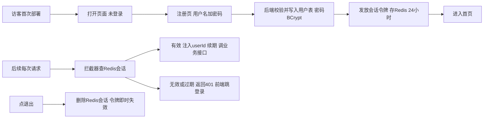

# AI 模拟面试平台 用户认证 账号密码改造方案

作者:Sakura（架构师 AI）| 创建时间:2026-11-01 12:30

状态：2026-11-01 用户指示开工。第 5 节 5 项待确认按推荐值执行——开放注册、密码最短 8 位、存量清库、APP_TOKEN 退役、侧栏显示用户名。A3 前端与 A4 文档由前端会话实施，A1/A2 后端由后端会话承接。

## 1 背景与问题

项目定位修正为**开源产品**：任何开发者可 clone 仓库自行部署使用，不是单机演示。当前认证为本地单用户 APP_TOKEN 模式（技术方案 4.2），在开源定位下有四个硬伤：

1. **首跑体验差**：新用户部署后第一次打开页面要求"从后端 .env 复制令牌"，要挖配置文件才能进门
2. **无会话管理**：静态令牌永不过期，无法登出失效、无法续期、泄露后只能改配置重启
3. **无账户概念**：简历属于敏感个人数据（需求文档 4.1），没有用户边界，多人部署会互相看到对方简历
4. **产品可信度**：开源项目的认证设计会被首先审视，令牌拼接式登录读起来像玩具

## 2 目标方案：注册登录 + Redis 会话 + 数据按用户隔离

沿用技术方案 4.2 已预留的"Redis Token 多用户升级路径"，落实为账号密码体系。

### 2.1 认证流程



### 2.2 会话令牌设计

| 项 | 设计 |
|---|---|
| 令牌形式 | 随机生成的不透明串（如 32 字节 hex），不编码任何信息 |
| 存储 | Redis `auth:session:{token}` → `{userId, createdAt}` |
| 有效期 | 24 小时，每次有效请求滑动续期 |
| 失效 | 退出登录即刻删除；改密码删除该用户全部会话 |
| 传输 | 现有 `Authorization: Bearer` 机制不变，前端 http.ts 零改动 |

### 2.3 接口契约变更（接口文档需同步修订）

```text
新增 POST /api/auth/register  入参 username password  出参 会话令牌  注册即登录
新增 POST /api/auth/login    入参 username password  出参 会话令牌
新增 POST /api/auth/logout   无入参  删除当前会话
变更 /api 拦截器             由比对 APP_TOKEN 改为查 Redis 会话并注入 userId
变更 全部面试接口            create/list/detail/chat/end/report 按当前 userId 过滤
```

会话出参建议：`data: { "token": "...", "username": "..." }`，前端存 localStorage 的键沿用现有 APP_TOKEN 键名以减少改动（值变为会话令牌）。

### 2.4 数据模型变更

```text
新增 t_user        用户表: id 用户名唯一 密码BCrypt散列 创建时间
变更 t_session     增列 user_id  建立索引  查询一律按 user_id 过滤
变更 t_message     经由 sessionId 间接隔离 无需改动
变更 t_report      经由 sessionId 间接隔离 无需改动
```

简历敏感数据随会话按用户隔离，天然满足需求文档 4.1 的隐私要求。

### 2.5 边界：明确不做

- 不做邮箱验证、找回密码、OAuth 第三方登录（开源轻量级，用户名密码足够）
- 不做角色权限体系（无管理员/普通用户之分，人人平权）
- 不做注册开关与邀请制（开放注册，本地部署者可自行控制暴露面）
- 不做 JWT（会话规模小，Redis 可随时失效比无状态令牌更安全直观）

### 2.6 密码与传输安全边界

**前端约束**（密码在浏览器内的处理）：

- 密码输入框默认 `type="password"` 掩码显示；提供文字型"显示/隐藏"切换（V1 风格禁图标，用文字标签实现，仅作用于当前输入框）
- `autocomplete` 按语义标注：登录 `current-password`、注册 `new-password`，密码管理器可正确识别
- 密码只存在于组件 state 与一次 POST 请求体：不写 localStorage、不进 URL、不打 console 日志，提交后表单立即重置
- localStorage 只存会话令牌——令牌可随时失效，泄露影响可控

**后端约束**（密码在服务端的处理）：

- 落库前 BCrypt 散列，数据库中永远没有明文
- 日志与异常堆栈过滤密码字段，任何接口出参不回显密码
- 登录接口限速：Redis 计数，同用户名连续失败 5 次锁定 1 分钟，防暴力破解

**传输约束**（密码在网络上的处理）：

- 明确不做"前端先加密再传输"：哈希串若被截获，攻击者拿它即可直接登录，等价于明文，属于伪安全
- 真正的传输防线是 TLS：本地部署走 localhost 回环不经网络，HTTP 即安全；部署到服务器时由部署者用 nginx 或 caddy 反代加 HTTPS，README 部署章节给配置示例

## 3 前端改动

改动集中且小：

| 文件 | 改动 |
|---|---|
| `LoginPage.tsx` | 令牌单输入框 → 用户名+密码双输入框（密码 `type="password"` 全程掩码，安全约束见 2.6），增加"注册并登录"切换，错误提示文案更新 |
| `LoginPage.css` | 增加注册/登录切换与双输入框的少量样式 |
| `api/auth.ts`（新建） | register/login/logout 三个方法 |
| `http.ts` | 不改（Bearer 机制原样复用） |
| `App.tsx` | 不改（RequireAuth 仍只检查本地是否有令牌） |
| `Sidebar.tsx` | 底部"退出"改为先调 logout 接口再清本地令牌；可显示用户名 |
| 提示文案 | 删除"令牌从 .env 复制"引导，改为开源产品常规文案 |

## 4 开发步骤拆分（跨前后端，后端部分由后端会话承接）

| 步骤 | 内容 | 归属 | 验证 |
|---|---|---|---|
| A1 | t_user 表 + BCrypt 注册/登录/登出接口 + Redis 会话 + 拦截器改造 | 后端会话 | curl 注册登录 401/200 全通 |
| A2 | 面试接口按 userId 过滤 + t_session 迁移 | 后端会话 | 两用户互相看不到对方会话 |
| A3 | 前端登录页改造 + auth API + 侧栏退出 | 前端会话（我） | 注册即登录、退出即失效、401 全站跳登录 |
| A4 | 文档同步：需求 4.2/7.1、技术方案 4.2/5、接口文档 1/4、前端页面方案 4.5 | 架构师 | 文档走查 |

依赖关系：A1 → A3 可并行开发联调；A2 必须在 A1 后；建议后端会话把 A1/A2 排在步骤 7（REST 全套）之前或合并实施，避免接口返工。

## 5 待确认事项

1. **注册开放性**：开放注册（推荐，开源常规）还是仅部署者用、注册需开关控制？（需用户确认）
2. **密码策略**：最短 8 位即可（推荐，不强制复杂度）？（需用户确认）
3. **存量数据归属**：现有 t_session 无 user_id，开发期无真实数据，建议直接清库或归属首个注册用户，不做通用迁移逻辑（需用户确认）
4. **APP_TOKEN 时代退役**：拦截器改会话后，.env 的 APP_TOKEN 及登录页"复制令牌"文案一并删除，不保留兼容期（需用户确认）
5. **用户名展示**：侧栏底部"本机模式"文案改为显示当前用户名？（需用户确认）

## 6 对"开源产品"定位的后续清单（本方案之外，另行立项）

认证只是开源化的第一块。完整开源体验还差：README 快速上手重写（面向陌生部署者）、docker-compose 一键起全栈、首次启动引导页、LICENSE 与开源协议选择、贡献指南。建议认证落地后逐项补。
