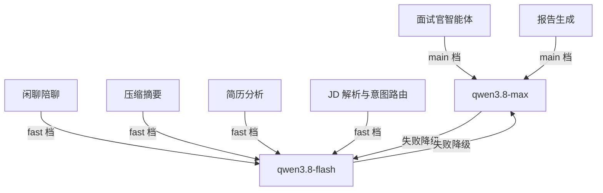
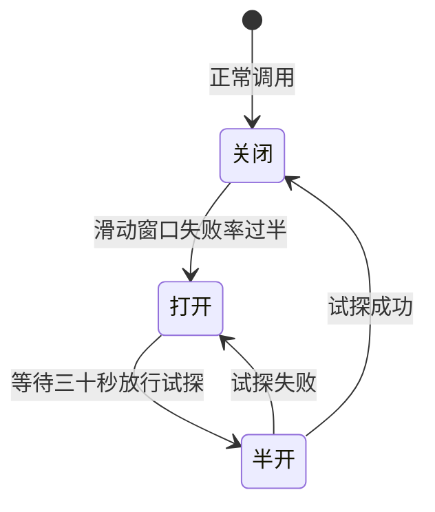
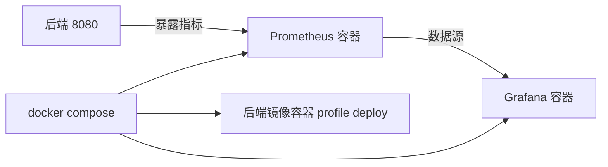

作者:Sakura | 创建时间:2026-11-01 15:05

# 稳定性与可观测-优化方案（步骤 8）

## 1 背景与目标

上一批把出题轮压到单次模型往返后，剩余短板变为三件事：

- **成本与响应**：压缩摘要、简历分析、JD 解析、意图路由、闲聊陪聊这些辅助调用，现在全走 qwen3.8-max 大模型。中转站已确认提供 qwen3.8-flash（同家族小快模型），辅助档切换后这些调用预计提速一到两倍、成本减半以上。
- **故障韧性**：中转站不可用时，每轮要等 120 秒超时才报错，熔断后应快速失败并自动降级到备用档。目前无熔断无限流。
- **可观测性**：README 技术栈承诺了 Resilience4j 与 Prometheus 加 Grafana，当前只有 actuator health 一个端点，没有任何业务指标。

**验收目标**：辅助调用走 flash 档且面试官与报告保持 max 档；主档故障自动降级且熔断打开时秒级失败；`/actuator/prometheus` 输出业务指标且 Grafana 能看到面板；`docker compose` 带 profile 可一键起完整栈。

## 2 方案设计

### 2.1 角色分级模型与降级链

- `ChatModels.chat(tier)` 增加档位参数：main 走现有模型配置；fast 走新增的 `OPENAI_MODEL_FAST` 等环境变量，未配置时回退主档模型（Ollama 与未注册的 DashScope 路天然兼容）。无参旧方法保留委托 main 档，QueryRewriter 显式传 fast
- `AgentScopeRuntime.buildAgent`：面试官传 main、闲聊传 fast，并给两档各挂对方为 `fallbackModel`（AgentScope 原生支持，步骤 4 核验过 Builder 有该参数）
- `AgentLlmCaller` 增加带档位的构造（默认 main），AppConfig 装配两个实例：`fastCaller` 供 ContextCompressor 与 Supervisor 的 invoker（路由与简历分析），`mainCaller` 供 ReportGenerator 的 invoker；LlmCaller 端口签名不变
- 单测口径不变：Fake 与 branchingCaller 本就与档位无关

### 2.2 Resilience4j 熔断与限流

- 依赖只加 `resilience4j-circuitbreaker`、`resilience4j-ratelimiter`、`resilience4j-micrometer`（程序式 API，不用 Spring Boot starter 的注解魔法，与端口化风格一致）
- **熔断装饰器**：`ChatModels.chat(tier)` 返回的 Model 用一个包一层的新类装饰——按档位各一个 CircuitBreaker（窗口 10 次、失败率 50%、半开等待 30 秒），调用成功失败计数后透传；熔断打开时直接抛出快速失败异常，经既有兜底路径变成友好错误（SSE error 事件或 invoker 重试）。接入点在 ChatModels 单一咽喉，运行时、一次性调用器、改写器全部生效
- **每用户限流**：ChatStreamService 增加可选 RateLimiter 注册表，按 userId 每分钟 10 轮，超限抛 429 信封。构造器保持三参重载（单测注入空注册表即不限流）
- 熔断与降级的关系：熔断管"别再打已死的服务"，fallbackModel 管"单次失败换备用档"，两层互补

### 2.3 业务指标与 Prometheus 暴露

- 依赖加 `micrometer-registry-prometheus`，application.yml 暴露 `health,prometheus`
- 指标埋点四处：
  - `interview_turn_seconds`（标签 action）——ChatStreamService.runTurn 收尾计时
  - `llm_call_seconds`（标签 tier 与 outcome 含 ok fallback fail）——熔断装饰器统一记录，天然覆盖全部模型调用
  - `sse_active`（Gauge）——ChatStreamService 在飞会话数
  - `report_task_seconds`——ReportWorker.process 计时
- Resilience4j 熔断器状态经 resilience4j-micrometer 自动进注册表
- ChatStreamService 与 ReportWorker 的新参数均做成可选重载，既有单测零改动

### 2.4 监控栈与应用容器化

- compose 增两组服务，均走 profile：`monitoring`（Prometheus 抓 host 点位、Grafana 预置数据源与面板 JSON，配置文件落 `backend/monitoring/`）；`deploy`（后端镜像服务，依赖 mysql redis milvus 健康后启动）
- 面板六块：面试轮时延 p50 与 p95、每轮 token、LLM 调用成功率与降级次数、熔断器状态、活跃 SSE 数、报告生成时长
- 应用镜像：多阶段不做——宿主机 `mvn package` 后 `eclipse-temurin 21-jre` 只装 jar（Windows 本机开发现实，构建快）
- README 快速开始更新为两条命令：开发期 `docker compose up -d` 只起中间件；初版部署 `docker compose --profile deploy --profile monitoring up -d` 起完整栈
- Grafana 端口 3000，默认账号 admin/admin；Prometheus 抓取目标开发期指向 `host.docker.internal:8080`

## 3 开发步骤与验证

**步骤 1 角色分级与降级链**：ChatModels 档位参数、EnvKeys fast 键、AgentLlmCaller 双实例、AppConfig 装配、.env.example 模板补键。验证：单测全绿；本地起服务后闲聊轮走 flash（日志打印模型名），面试轮仍 max；改错主档模型名验证 fallbackModel 生效。

**步骤 2 熔断与限流**：pom 加 resilience4j 三件、Model 装饰器、ChatStreamService 限流重载。验证：新增单测（装饰器成功失败计数与打开后快速失败、限流超限 429）；改错 baseUrl 连续调用观察熔断打开后毫秒级失败。

**步骤 3 指标埋点与暴露**：micrometer 依赖、四处埋点、yml 暴露。验证：curl `/actuator/prometheus` 见 interview_turn 与 llm_call 序列；单测绿。

**步骤 4 监控栈**：compose 两个服务、monitoring 配置与面板 JSON、README 更新。验证：`docker compose --profile monitoring up -d` 后 Grafana 3000 打开见面板出数、Prometheus targets Up。

**步骤 5 应用镜像与一键栈**：Dockerfile、compose deploy 服务、README。验证：`docker compose --profile deploy up -d` 全栈健康、容器内后端过一轮真实对话与报告生成。

每步独立 commit 并 `git cherry main frontend` 核对同步，全量单测绿后推 main。

## 4 需求清单

- [ ] ChatModels 档位分派与 fast 模型配置键
- [ ] 面试官与报告 main 档，闲聊压缩路由简历 JD 为 fast 档
- [ ] 两档互挂 fallbackModel 降级链
- [ ] 熔断装饰器按档位独立，打开后快速失败
- [ ] 每用户每分钟 10 轮限流返回 429
- [ ] 四处业务埋点与 prometheus 端点暴露
- [ ] Prometheus 与 Grafana 容器及预置面板
- [ ] 后端镜像与 deploy profile 一键栈
- [ ] README 双命令口径更新

## 5 待确认事项

1. fast 档选型定为 qwen3.8-flash（同家族、中转站在列），报告生成保持 max 档以保评分质量。（需用户确认）
2. 限流默认每用户每分钟 10 轮、熔断失败率 50% 窗口 10 次，阈值写成常量可后续再调。（需用户确认）

## 6 明确不做

- 不做 PromQL 告警规则与通知渠道（步骤 9 后再看）
- 不做链路追踪（Tracing），Micrometer 指标足够本阶段口径
- 不做分布式限流（Redis 计数），单机 RateLimiter 足够
- 不改前端（指标只进后端与 Grafana）
- 步骤 9 的评测集与 RAG 增益验证不在本批
- 不引入 Resilience4j Spring Boot starter 与注解式用法
