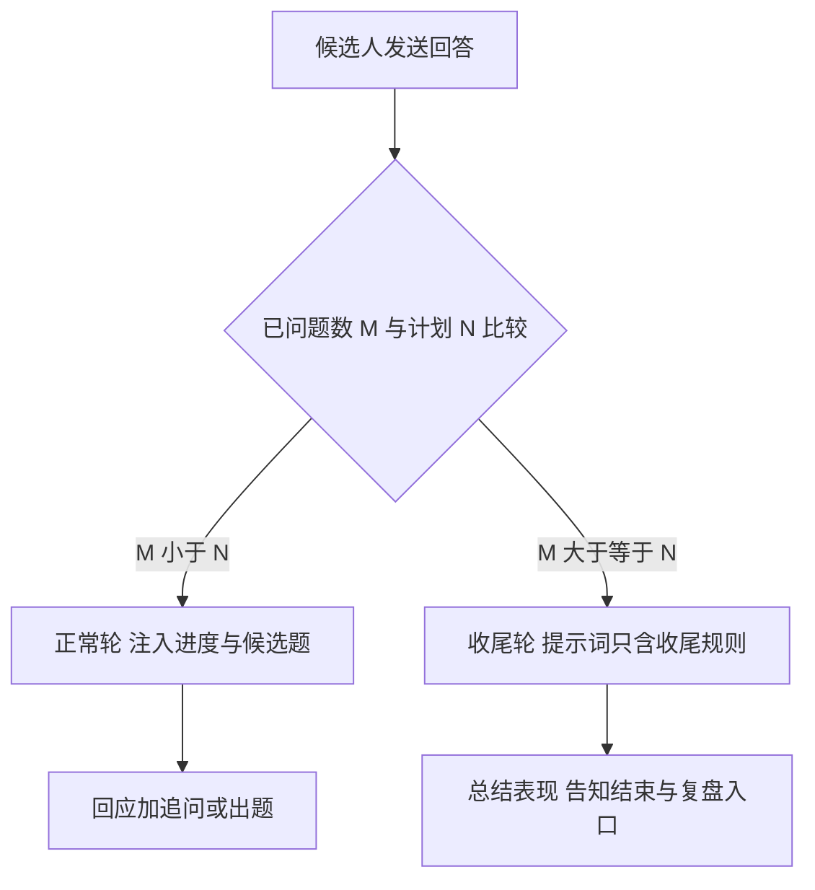

作者:Sakura | 创建时间:2026-11-01 15:40

# 面试收尾-优化方案

## 1 背景与目标

实测 s-e83d85db 问满配置的 10 道题后面试官仍继续出第 11 道。根因：questionCount 只用于前端进度分母与配置落库，面试官系统提示词不知道计划题数与已问题数，也没有问满收尾规则。目标：问满计划题数后面试官不再出题，改为总结本场表现并引导生成复盘报告。

## 2 方案设计

- SessionStore 端口新增 `countQuestions(sessionId)`：数 role 为 interviewer 且 action 为 QUESTION 或 NEXT 的消息行（开场白 action 是 QUESTION，与前端第 1 题口径一致）；MySQL、Persistent、Fake 三处实现
- `Supervisor` 面试官分支先取已问题数：未问满走候选题预检索与现行规则；已问满跳过检索（无新题无需候选），提示词切换为收尾规则
- `Prompts.interviewerSystem(state, askedCount, candidates)`：
  - 头部注入进度行「本场进度：计划 N 道题，已问 M 道」
  - 未问满：现行规则不变，追问出题规则补一句「出最后一道题时说明这是本场最后一道」
  - 已问满：替换为收尾规则——两三句总结整体表现（一个亮点加一个待补强短板），告知面试结束、可点击结束面试生成复盘报告；后续任何输入都礼貌引导结束，不展开新话题

## 3 边界与不做

- 不自动翻转会话状态为 ENDED：结束仍由用户点击，防模型不守约导致面试卡死无人工闸门
- 收尾轮 action 仍按无选题标记判 FOLLOW_UP，题号不推进，前端无需改动
- 不改闲聊与报告链路

## 4 验证

- 单测：问满后系统提示词含收尾规则且不含出题规则；未问满时相反；countQuestions 的 Fake 实现与生产 SQL 口径一致（开场白计入）
- 端到端：新建 questionCount 为 2 的会话真实跑三轮——首轮出题预告最后一道、次轮收尾总结、无第三道题；既有 97 测全绿
