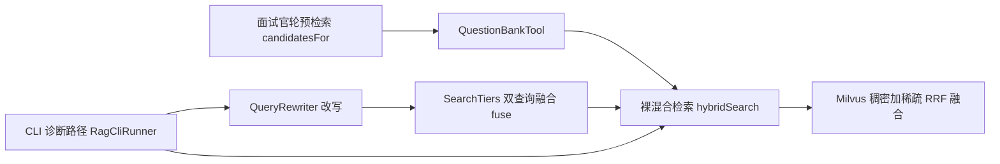
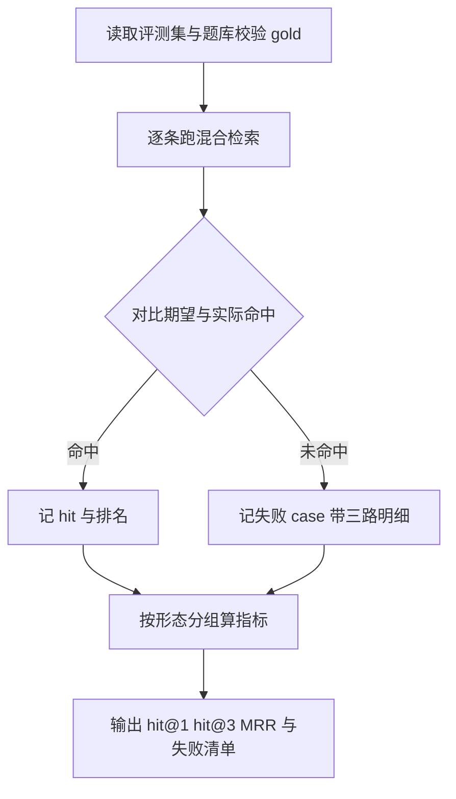

# 检索评测与调优-优化方案

作者:Sakura | 创建时间:2026-11-02 12:40

## 一、目标与边界

路线图最后一步（步骤 9）：给题库混合检索建一套小而准的评测集，量化质量、
修复已知的压制问题、给分档补上阈值依据，产出 RAG 增益的验证记录——
把简历里"题库检索提升出题质量"这句话变成有数据的口径。

- [ ] 评测集：约 40 条查询，三种形态分层，gold 唯一为主
- [ ] 评测命令与基线指标：hit@1、hit@3、MRR 按形态分组
- [ ] 压制问题修复：混合高频查询具体题被概念题压过
- [ ] 分档阈值定标：解决 RRF 分不可跨查询比较
- [ ] RAG 增益小样本验证记录

边界：单人自评口径；不换 embedding 模型；不引入 rerank 模型（网关无现成
reranker，引入即新增外部依赖）；数据批次 3 的 11 个 XMind 不混入本步。

## 二、现状与问题清单

检索链路现状（关键发现用加粗标出）：



**QueryRewriter 与双查询融合只接在 CLI 诊断路径，生产预检索从未走改写。**
这是本步要量化的第一个变量，但不在生产路径接它——预检索优化刚把模型调用
移出面试官轮关键路径，接改写器等于加回一次 fast 往返，得不偿失。

问题清单：

1. **压制问题**：混合高频查询（如"Agent 死循环怎么防"）时具体题 AG-010
   被概念题压过。根因假设：searchText 为题干加要点加标签，要点文本长、
   词频主导 BM25，概念题要点里高频词出现次数多
2. **分档无阈值**：SearchTiers 只按查询长度调 topK（12 字以内取 3 否则取 5），
   RRF 分跨查询不可比，没有"命中置信度"信号，注释明确留给本步验证
3. **改写器对问题 case 静默返回原文**：改写价值未知，需评测量化
4. **RAG 增益未验证**：出题质量提升是设计预期，缺数据

## 三、评测集设计

沿用题库文件的行前缀风格，新增 `backend/question-bank/eval-set.md` 与
`rag/EvalSetParser`（与 QuestionBankParser 同套路：字段不全即抛错）：

```markdown
## E-001
查询：Agent 死循环怎么防
期望：AG-010
形态：混合高频
备注：已知压制 case 修复验收项
```

三种形态分层，共约 40 条（152 题按前缀分层抽样，人工各写一条查询）：

| 形态 | 条数 | 例 | 测什么 |
| --- | --- | --- | --- |
| 术语直查 | 15 | 索引失效场景 | 基线应接近全对 |
| 口语化 | 15 | 锁过期了业务还没执行完咋办 | 语义召回能力 |
| 混合高频 | 10 | Agent 死循环怎么防 | 已知问题区 |

gold 唯一为主；确实难分时允许多 gold（命中任一算对）。构造时跑校验：
期望题号必须存在于当前题库，防止评测集与题库脱节。

## 四、评测命令与指标

`RagCliRunner` 加 `eval` 命令，评测逻辑独立成 `rag/RetrievalEval.java`
（300 行红线，Runner 只做接线）：



- 指标：hit@1、hit@3、MRR，按形态分组；失败清单带查询、期望、实际 top3
  与稠密加稀疏各自排名（诊断用，denseSearch 与 sparseSearch 现成）
- 对照模式：`--rewrite` 跑改写器双查询口径，量化"改写值多少"作为上限参考

## 五、压制问题修复实验（评测数据驱动）

按成本从低到高逐个实验，评测集对比留最优、其它形态不回退才收：

1. **题干加权**（主修候选）：searchText 构造改为题干重复两到三次再拼要点标签，
   让题干关键词在 BM25 与稠密输入里权重更高；改构造需重建 collection 数据
2. **RRF 融合参数**：k 从 60 试 20 与 100（调排名靠后项的压制强度）
3. **analyzer 与 BM25 参数**：确认 Milvus 2.6 可调面后小范围实验
4. **改写器**：仅作评测对照量化上限，不接生产路径（理由见二）

## 六、分档阈值定标

先用评测集把分布量出来再定规则，不拍脑袋：

- 采集全量评测集的 top1 与 top2 RRF 分差、top1 分与理论满分比
- 候选信号：分差足够大判高置信；分差小于阈值判"题库无合适题"，
  走 QuestionBankTool 已有的自行出题分支
- 产出：阈值常数落 SearchTiers，评测集上验证误判率

## 七、RAG 增益验证

两层数据支撑简历口径：

1. **检索层**：评测集 hit 率即"岗位方向加回答能从题库召回合适题"的直接证据
2. **出题层**：10 例小样本人工对照——同一场配置开与关候选题注入各跑一场会话，
   记录面试官实际出的题与预检索候选题的重合度与贴题度，形成记录文档

不为对照加产品开关：关候选题用空 questionBank 注入即可（构造器已支持）。

## 八、开发步骤（每步可验证）

1. 评测集文件加 EvalSetParser 加 gold 校验
   验证：校验全过，40 条与题库对得上
2. RetrievalEval 加 eval 命令
   验证：跑出三形态基线指标与失败清单
3. 修复实验：题干加权先行，逐个对照
   验证：混合高频 hit@1 回升且其它形态不回退；AG-010 case 修复
4. 分档阈值定标落地
   验证：低置信 case 的无合适题判定与人工预期一致
5. RAG 增益小样本记录加文档收尾
   验证：记录文档入 .agentdocs，指标写入实现记录

## 九、不做什么

- 不接 rerank、不换 embedding 模型、不建自动标注
- 不把改写器接进生产预检索路径（会加回一次模型往返）
- 不追求工业级评测框架（自建两百行内）
- 数据批次 3 的 11 个 XMind 另行安排

## 十、待确认事项

1. 评测集 40 条手写约 2 到 3 小时（需用户确认规模）
2. 修复主攻题干加权，RRF 与 BM25 参数为备选实验（需用户确认）
3. RAG 增益用 10 例小样本人工对照（需用户确认）
4. 改写器只做评测对照不接生产路径（需用户确认）
