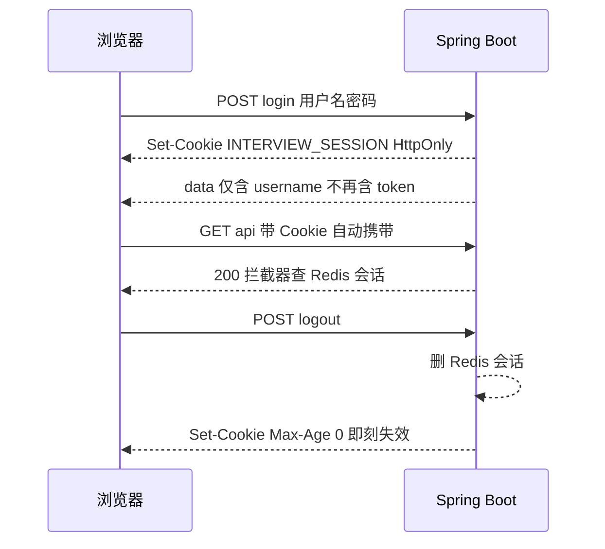

# AI 模拟面试平台 用户认证 Cookie 模式 优化方案

作者:Sakura | 创建时间:2026-11-02 10:30

状态：用户已授权"出完直接做，安全第一"，方案与实现同轮完成。

## 1 背景与目标

当前认证为 Bearer 令牌模式：登录接口把会话令牌放在响应体，前端存 localStorage、每次请求带 Authorization 头。该模式免疫 CSRF，但 **localStorage 里的令牌 JS 可读**——一旦出现 XSS，令牌即被窃取。

用户拍板"安全第一"，升级为 **HttpOnly Cookie 模式**：凭据存 Cookie 且 JS 不可读，XSS 偷不走会话令牌，这是浏览器端凭据存储的最高水位。

## 2 设计

### 2.1 Cookie 属性

| 属性 | 值 | 理由 |
|---|---|---|
| HttpOnly | 开 | JS 读不到凭据，本方案核心 |
| SameSite | Strict | 防 CSRF；全站同源架构下零使用成本 |
| Path | /api | 静态资源请求不带凭据，缩小暴露面 |
| Max-Age | 86400 | 与 Redis 会话 TTL 24 小时对齐 |
| Secure | 配置项 auth.cookie.secure 默认关 | localhost 回环无需 TLS；局域网裸 HTTP 访问会因 Secure 挂掉；HTTPS 反代部署时由部署者开启（沿用认证方案 2.6 传输约束口径） |

Cookie 名 `INTERVIEW_SESSION`，值为现有 32 字节随机 hex 令牌，Redis 会话层零改动。

### 2.2 协议变化

- **Bearer 通道整体移除**：拦截器只认 Cookie，登录响应体不再返回 token——单一凭据通道，攻击面与审计口径最小化
- 脚本测试改用 curl cookie jar：`curl -c jar -b jar`
- 前端不再持有令牌本体：localStorage 只存非敏感的登录标志 `APP_LOGGED_IN` 与用户名 `APP_USERNAME`（RequireAuth 同步判断用），401 时统一清除并跳登录

### 2.3 改动面

| 端 | 文件 | 改动 |
|---|---|---|
| 后端 | AuthController | 登录注册 Set-Cookie；登出清 Cookie；响应体去掉 token |
| 后端 | AuthInterceptor | 从 Cookie 取令牌（移除 Bearer 分支） |
| 后端 | application.yml | auth.cookie.secure 配置占位 |
| 前端 | http.ts | 移除令牌存取与请求头；新增登录标志存取；credentials same-origin |
| 前端 | auth.ts | 三个接口调用保留；用户名存取挪至 http.ts |
| 前端 | App.tsx / LoginPage / Sidebar / interviewStream.ts | 登录态判断与清理跟随调整 |

## 3 验证

- 后端：AuthServiceTest、InterviewApiTest 回归 + 编译
- 前端：tsc 零报错、单测 19/19
- E2E（8081 mock 按 Cookie 契约）：注册登录进首页、**document.cookie 读不到会话 Cookie（HttpOnly 逐字验证）**、登出后接口 401 全站跳登录、登录标志丢失模拟 Cookie 过期场景
- 收尾：前端构建进 static、后端重启后真机复验

## 4 边界与不做

- 不做 CSRF token：SameSite=Strict 已覆盖
- 不做 remember-me 持久 Cookie：24 小时滑动续期已够
- Redis 会话结构、BCrypt、限速、数据隔离全部不动
