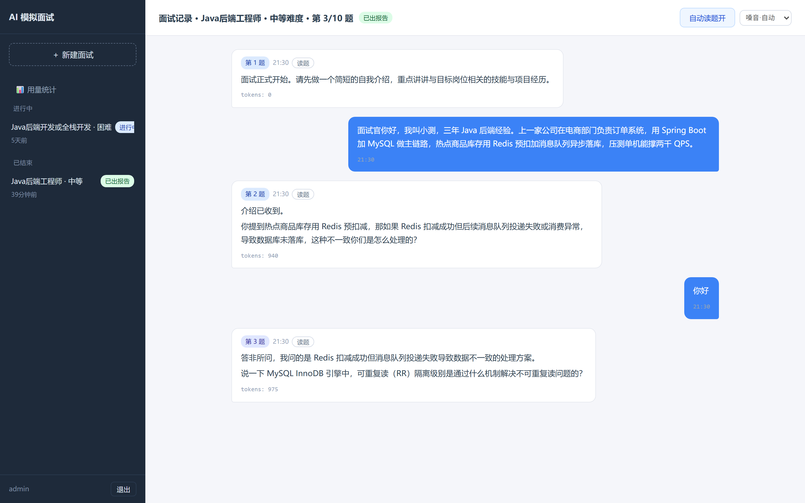
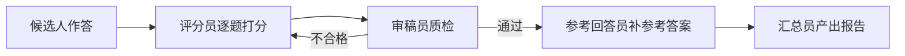
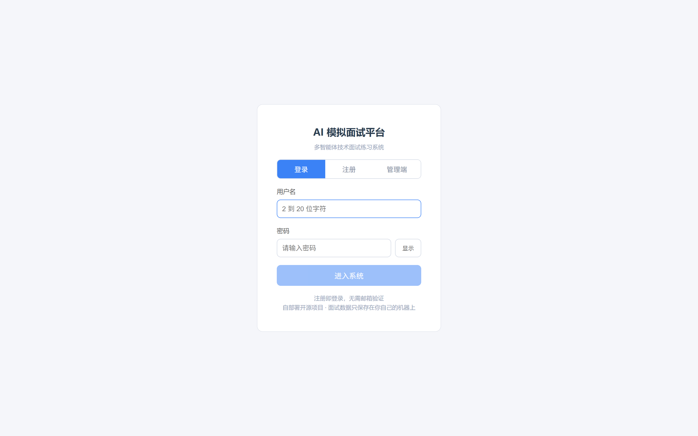
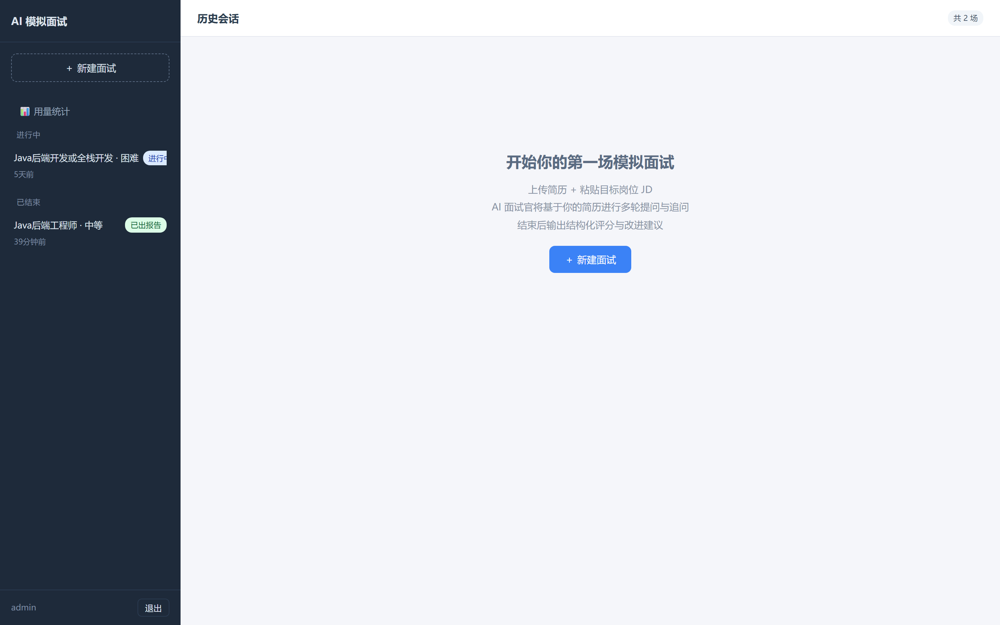
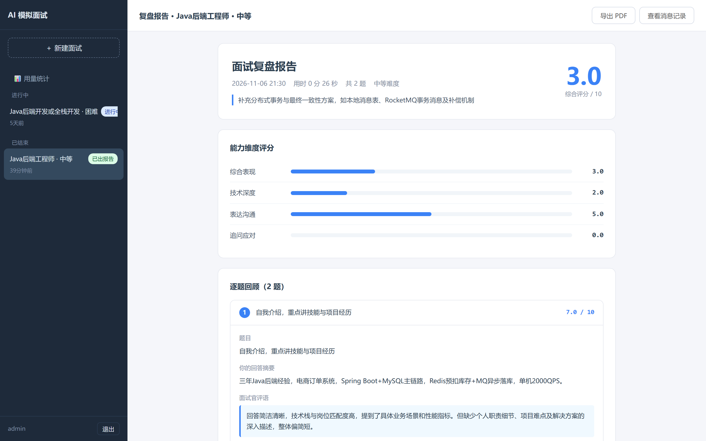
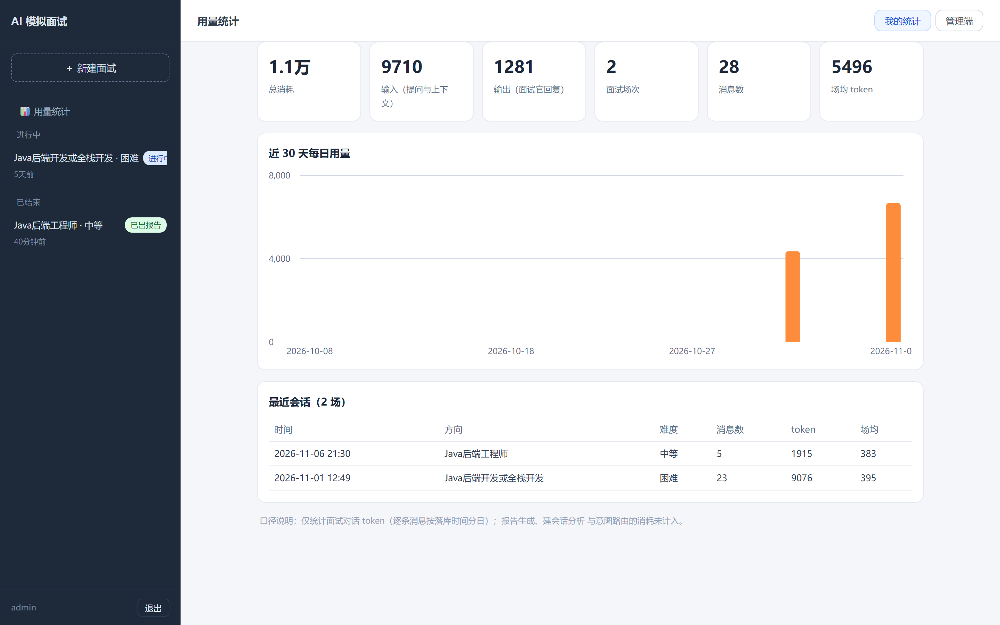

# AI 模拟面试平台（mockInterview）

[](https://github.com/Sakura-hexo/mockInterview/actions/workflows/ci.yml)

输入简历与 Java 后端岗位描述，AI 面试官进行多轮提问与追问，结束后四个智能体协作产出逐题评分与复盘报告。前后端同仓库同源部署：前端构建产物零拷贝进 Spring Boot static，浏览器直开 8080 即用。



## 功能特性

**面试主线**

- 简历与 JD 输入（文本或 PDF），一次模型调用完成简历摘要与岗位画像
- AI 面试官多轮提问与追问，SSE 流式逐字返回；三档难度对应不同面试官人设
- 出题走 RAG 混合检索：Milvus 稠密向量加 BM25 稀疏检索 RRF 融合，题库 152 题
- 行为纠偏：明确拒绝直接换题；无效作答严肃点名并换题，连续三次三振出局提前收场；开题后的闲聊按跑题作答处理
- 长会话上下文压缩：前情摘要加最近窗口组装，会话可跨重启恢复

**语音**

- 读题服务端合成：edge-tts 边车容器输出微软神经嗓音（晓晓、云希、云扬），失败自动回落浏览器朗读
- 语音输入：浏览器原生语音识别（Web Speech API）

**复盘报告**

- 面试结束异步生成，评分员、审稿员、参考回答员、汇总员四个智能体协作闭环：



- 逐题评分、亮点与短板、针对缺口的改进建议与参考回答

**平台与工程化**

- 注册登录 Cookie 会话；内置管理端账号与全平台数据看板（用量趋势图表）
- GitHub Actions CI 三线并行：后端单测、前端单测与构建、镜像构建验证
- k6 压测脚本（对话链路与静态资源）；Prometheus 加 Grafana 监控栈一键起
- 六边形端口化：AgentRuntime 端口隔离智能体引擎，FakeAgentRuntime 支撑无模型单测（后端 269 例、前端 65 例）

## 界面展示

**登录页**（候选人 / 管理端双入口）



**历史会话**



**复盘报告**（逐题评分与改进建议）



**管理端数据看板**



## 快速开始

一键部署（完整栈：应用 + MySQL + Redis + Milvus + 监控）：

```bash
cd frontend && npm install && npm run build   # 前端产物零拷贝进 backend static
cd ../backend
cp .env.example .env                          # 填入模型密钥（如 DASHSCOPE_API_KEY）
mvn package -DskipTests
docker compose --profile deploy --profile monitoring up -d
```

浏览器打开 `http://localhost:8080`，注册即用；管理端用内置账号 `admin / admin` 登录。可选在 `.env` 加 `TTS_PROVIDER=edge` 开启服务端读题语音。

命令行最小面试官（只依赖模型密钥，零中间件）：

```bash
cd backend && mvn compile exec:java
```

开发模式、端口清单与常见问题见 **[使用方法](使用方法.md)**。

## 技术栈

Java 21、Spring Boot 3.4、AgentScope-Java 2.0、React 18、Vite、MySQL 8、Redis 7、Milvus 2.6（混合检索）、edge-tts（语音合成边车）、Prometheus、Grafana、k6、Docker Compose、GitHub Actions。

## 目录结构

```text
mockInterview/
├── backend/     Spring Boot 后端与智能体编排
├── frontend/    React 前端（构建产物零拷贝进后端 static）
├── docs/        界面截图
└── 使用方法.md   部署、使用与开发速查
```
