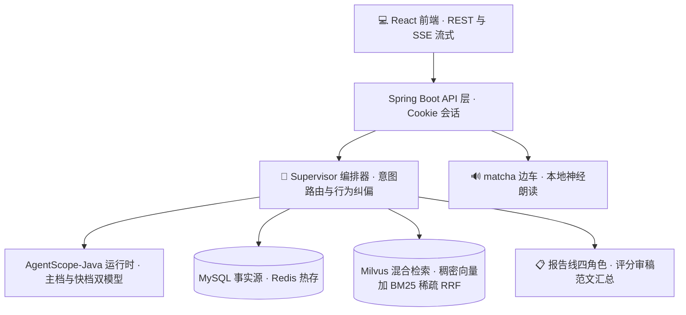
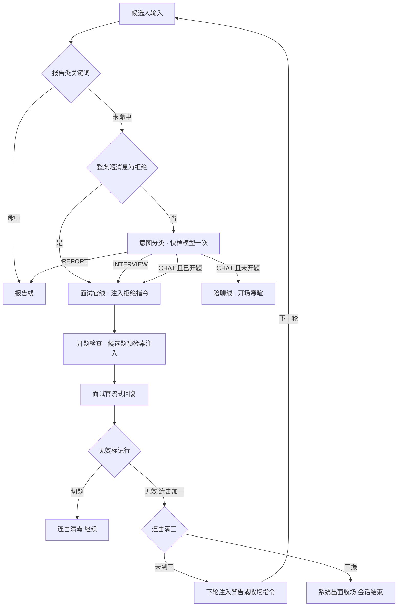
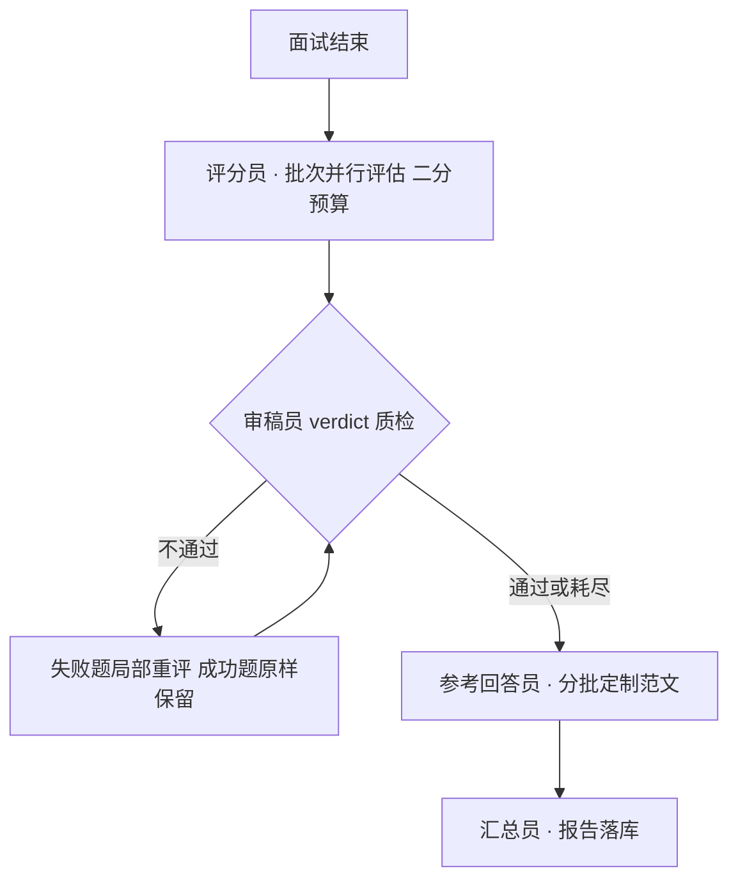

# AI 模拟面试平台（mockInterview）

[](https://github.com/Sakura-hexo/mockInterview/actions/workflows/ci.yml)

输入简历与 Java 后端岗位描述，AI 面试官进行多轮提问与追问，结束后四个智能体协作产出逐题评分与复盘报告。前后端同仓库同源部署：前端构建产物零拷贝进 Spring Boot static，浏览器直开 8080 即用。


## 功能特性

**面试主线**

- 简历与 JD 输入（文本或 PDF），一次模型调用完成简历摘要与岗位画像
- AI 面试官多轮提问与追问，SSE 流式逐字返回；三档难度对应不同面试官人设
- 出题走 RAG 混合检索：Milvus 稠密向量加 BM25 稀疏检索 RRF 融合，题库 152 题
- 行为纠偏：明确拒绝直接换题；无效作答严肃点名并换题，连续三次三振出局提前收场；开题后的闲聊按跑题作答处理
- 长会话上下文压缩：前情摘要加最近窗口组装，会话可跨重启恢复

**语音**

- 读题服务端合成：本地 matcha 边车容器（中英双语、RTF 0.03 约一秒出声），失败自动回落浏览器朗读
- 语音输入：本地 SenseVoice 边车识别（长音频按静音分段），浏览器原生识别兜底

**复盘报告**

- 面试结束异步生成，评分员、审稿员、参考回答员、汇总员四个角色协作闭环（流程见下方系统架构）
- 逐题评分、亮点与短板、针对缺口的改进建议与参考回答

**平台与工程化**

- 注册登录 Cookie 会话；内置管理端账号与全平台数据看板（用量趋势图表）
- GitHub Actions CI 三线并行：后端单测、前端单测与构建、镜像构建验证
- k6 压测脚本（对话链路与静态资源）；Prometheus 加 Grafana 监控栈一键起
- 六边形端口化：AgentRuntime 端口隔离智能体引擎，FakeAgentRuntime 支撑无模型单测（后端 189 例、前端 68 例）

## 🏗️ 系统架构

双线编排：**面试线时延敏感——规则与状态机做第一道门，模型只兜底；报告线质量优先——四角色委派协作，异步无感**。



### 面试线：行为纠偏闭环（规则第一道门，模型只兜底）



| 触发 | 检测方式 | 动作 | 额外模型调用 |
|---|---|---|---|
| 「复盘」「生成报告」等命令 | 关键词规则 | 切报告线 | 0 |
| 整条短消息为拒绝或不会 | 关键词规则（RefusalDetector） | 跳过分类直通面试线，注入本轮指令：一句带过立即换题、禁止劝答 | 0 |
| 其余输入 | 快档意图分类 | INTERVIEW / CHAT / REPORT 三路分发 | 1 |
| 分类为闲聊且本场已开题 | 状态判定 | 重路由面试官线按跑题作答：严肃点名、无效标记、换题、连击计一 | 0（复用分类结果） |
| 回复带「选题 无效」标记行 | 提示词契约，代码全文行扫描 | 连击执法：一振下轮注入警告、二振注入收场指令、三振系统模板收场并结束会话 | 0（模型违规出新题时模板桥接，仍零调用） |
| 未问满却出现告别话术 | 关键词规则（FarewellDetector） | 带指令重试一次；仍失败用预检索候选题确定性桥接补题 | ≤1 |

### 报告线：审稿回炉闭环（质量线，异步无感）



回炉至多 2 轮，耗尽后该题评语标注「评分经复核存疑」放行、分数不动；审稿员或参考回答员失败一律静默降级（跳过质检 / 范文留空），不阻断报告产出——**评分并行批生效后，报告总耗时较单模型版不升反降**。

### 耗时演进（同场景真实链路实测）

| 环节 | 改造前 | 架构改造后 | DeepSeek flash 复测 | 关键变化 |
|---|---|---|---|---|
| 出题轮端到端 | 19-33 s（ReAct 多轮工具循环，输入随轮数翻倍） | 14.6-20.5 s | **2.9-3.0 s** | 候选题预检索注入提示词单轮直出，面试官工具全卸载 |
| 创建会话 | 4.1 s（同步等分析模型） | 64 ms | **22 ms** | 占位落库秒回，分析后台回填，首轮自动兜底 |
| 上下文压缩 | 20-60 s 阻塞回复 | 回复完成后 458 ms 触发 | —（异步触发开销，与模型无关） | 压缩移出 SSE 关键路径，后台落库 |
| 复盘报告（2 题） | 15-30 s（单模型直出） | 24 s（四角色协作） | **12.0 s** | 评分并行批、审稿回炉、范文回填——质量升级时延不升 |

> 末列为 2026-11-07 真机复测：DeepSeek flash、MEDIUM 难度 2 题会话，出题轮取两轮 SSE 端到端实测、报告取任务落库到 DONE 的墙钟差。压缩行测的是回复完成后的异步触发开销，2 题会话不满足触发条件（窗口外积压 ≥10 条），沿用架构改造期实测值。

## 界面展示

**登录页**（候选人 / 管理端双入口）


**历史会话**


**复盘报告**（逐题评分与改进建议）


**管理端数据看板**


## 快速开始

一键部署（完整栈：应用 + MySQL + Redis + Milvus + 监控）：

```bash
cd frontend && npm install && npm run build   # 前端产物零拷贝进 backend static
cd ../backend
cp .env.example .env                          # 填入模型密钥（如 DASHSCOPE_API_KEY）
mvn package -DskipTests
docker compose --profile deploy --profile monitoring up -d
```

浏览器打开 `http://localhost:8080`，注册即用；管理端用内置账号 `admin / admin` 登录。可选在 `.env` 加 `TTS_PROVIDER=local` 开启服务端读题语音。

命令行最小面试官（只依赖模型密钥，零中间件）：

```bash
cd backend && mvn compile exec:java
```

开发模式、端口清单与常见问题见 **[使用方法](使用方法.md)**。

## 技术栈

Java 21、Spring Boot 3.4、AgentScope-Java 2.0、React 18、Vite、MySQL 8、Redis 7、Milvus 2.6（混合检索）、sherpa-onnx（本地语音边车：matcha 合成与 SenseVoice 识别）、Prometheus、Grafana、k6、Docker Compose、GitHub Actions。

## 目录结构

```text
mockInterview/
├── backend/     Spring Boot 后端与智能体编排
├── frontend/    React 前端（构建产物零拷贝进后端 static）
├── docs/        界面截图
└── 使用方法.md   部署、使用与开发速查
```
